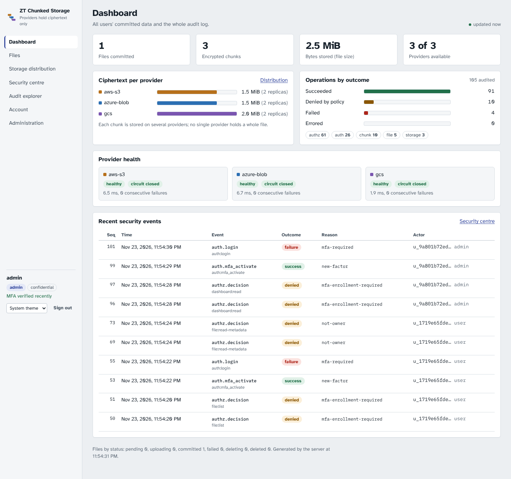
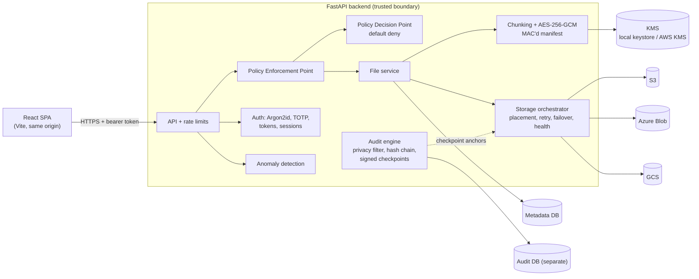
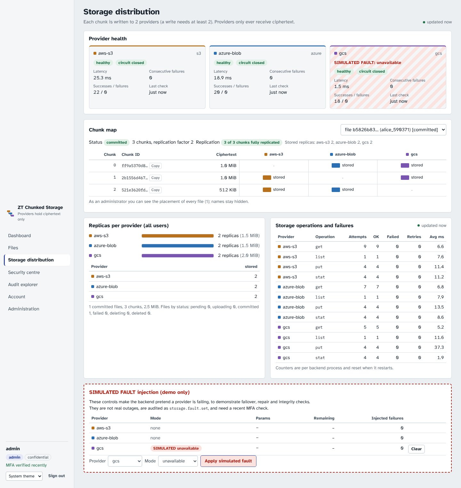
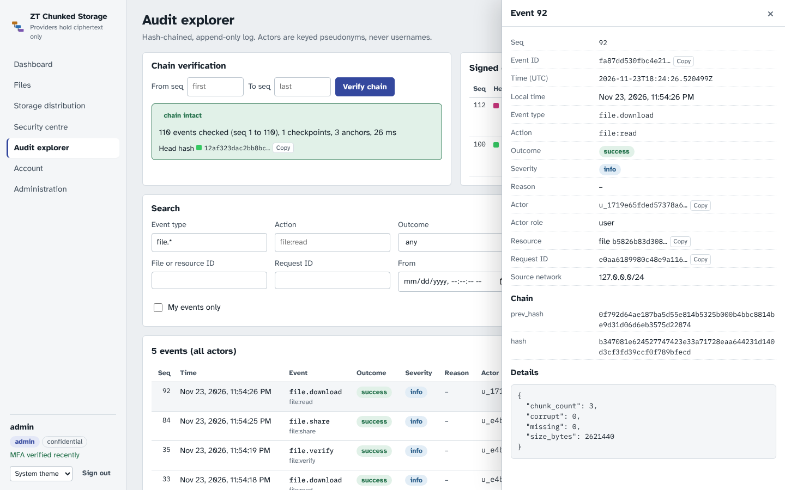

# Zero-Trust Multi-Cloud Chunked Storage Framework with Privacy-Aware Audit Logging

In 2024 the UNC5537 campaign against Snowflake customer instances needed no exploit. Passwords stolen by
infostealer malware worked on accounts without MFA or network allow lists, and once logged in the
platform's ordinary functions returned plaintext. Encryption at rest did not help, because it was built
for a different threat. This project is a storage backend and web console built around that lesson.
Every request is authenticated and authorised again (zero trust). A password alone opens only MFA
enrolment. Files are split into chunks, each chunk is encrypted with AES-256-GCM, and replicas are spread
across three storage providers (S3, Azure Blob, GCS), so one leaked provider credential yields only
ciphertext fragments. Every security-relevant action goes into a hash-chained, signed and externally
anchored audit log that stores no usernames, filenames, tokens or full IP addresses.

Course project for the **Cloud SRE and Security** course, IIIT Dharwad.
The accompanying article is in [`paper/main.pdf`](paper/main.pdf) (LaTeX source alongside).



## From the case study to controls

| UNC5537 / Snowflake weakness | Control in this system | Evidence |
|---|---|---|
| Password-only accounts | TOTP MFA required at sign-in by default; a password-only session can only enrol MFA (and only inside a 24 h trust-on-first-use window, otherwise with an admin code); step-up MFA for confidential downloads, delete, share, admin and password change | S11 tests, `tests/review/test_review_auth.py` |
| Credentials valid for years | 5-min EdDSA access tokens; single-use rotating refresh tokens with reuse detection; idle and absolute session limits; session and user re-read on every request | S02, S14, S15 |
| No network allow lists | Per-user CIDR allow list on login, refresh, account endpoints and every policy-checked route | S12 |
| Bulk export through normal functions | Per-request policy decision (PDP/PEP, default deny); download count and volume detection that alerts and blocks | S13 |
| Over-broad permissions | RBAC + ownership + classification/clearance; admins cannot read file content; auditors see pseudonyms only | S03, S04 |
| Encryption did not stop a logged-in attacker | Keys are unwrapped only after an allow decision; envelope encryption (per-file DEK, KMS-wrapped); providers hold no keys | S06, S09 |
| Investigation depended on logs | Tamper-evident audit log (hash chain, Ed25519 checkpoints, anchors on the providers), privacy-filtered | S08, S17 |

Full mapping (R1–R10): [`docs/ARCHITECTURE.md`](docs/ARCHITECTURE.md) §1.

## Architecture



Documentation: [Architecture](docs/ARCHITECTURE.md) · [Threat model](docs/THREAT_MODEL.md) ·
[Design decisions (ADR-0001 to ADR-0012)](docs/adr/README.md) · [REST API](docs/API.md) ·
[Security testing](docs/SECURITY_TESTING.md) · [Final report](docs/FINAL_REPORT.md) ·
[Module contracts](docs/CONTRACTS.md) · [Web UI](frontend/README.md) · [Containers](deploy/README.md)

## Features

- **Authentication:** Argon2id passwords with a policy, TOTP MFA (QR enrolment, step-up dialog), lockout with
  atomic attempt reservation, per-IP and per-user rate limits, uniform registration answer (no username
  enumeration), admin enrolment codes and MFA reset for recovery.
- **Authorisation:** a pure PDP evaluating (subject, action, resource, context) with reason codes and
  obligations (`step-up-mfa`, `enroll-mfa`); a PEP on every sensitive route; admin and auditor separation of
  duties; runtime policy settings that can be changed with an audit record.
- **Storage:** 1 MiB chunks, AES-256-GCM with AAD = (version, file id, index, final flag), HKDF key
  separation, an HMAC'd manifest as the only source of truth, replication factor 2 over 3 providers, retries
  with backoff, circuit breaker, health monitor, verify-then-release downloads, verify/scrub and repair,
  crypto-shredding on delete.
- **Audit:** pseudonymous actors (HMAC), allow-listed detail fields, /24 and /48 IP generalisation, a hash
  chain, Ed25519-signed checkpoints anchored on every provider in a per-log namespace, chain verification,
  retention that cuts only at signed checkpoints, NDJSON export.
- **Detection:** bulk-download (count and bytes) blocks, credential-stuffing alerts across accounts,
  refresh-token reuse alerts, aggregated rate-limit and invalid-token events.
- **Web console:** dashboard, file manager (upload, SHA-256-checked download, share, verify, repair,
  delete), storage distribution chunk map with simulated-fault controls, security centre, audit explorer
  with chain verification, account (MFA, sessions, password) and administration, in light and dark themes.

## Quick start

Requirements: Linux or macOS (or WSL), Python 3.11+, Node.js 20+. **No cloud account and no Docker needed.**
Details in [`QUICKSTART.md`](QUICKSTART.md).

```bash
bash scripts/setup.sh      # venv + backend deps, Azurite, frontend deps (one time)
scripts/demo.sh            # 16-step end-to-end demonstration against the real server and emulators
scripts/run-dev.sh         # backend + emulators (set ZT_BOOTSTRAP_ADMIN_USERNAME/_PASSWORD first);
                           # then in another terminal: cd frontend && npm run dev  -> http://localhost:5173
```

## Demo

`scripts/demo.sh` starts the emulators and the backend by itself. It registers users, enrols TOTP, uploads a
4-chunk file, shows where each chunk went, reads the raw ciphertext at each provider through its own SDK,
downloads and verifies the file, and shows denied access (other user, anonymous, admin). It then flips a
byte at one provider, tampers with the audit DB, kills the GCS emulator, shows the matching audit trail and
cleans up. Last run (2026-11-25): `46/46 checks passed`. Transcript:
[`docs/demo-output.txt`](docs/demo-output.txt).

| Storage distribution with a simulated provider fault | Audit explorer: chain verified, event drawer |
|---|---|
|  |  |

All 30 screenshots in [`docs/screenshots/`](docs/screenshots/) were taken on 2026-11-23 by the live
Playwright walk-through `frontend/e2e/live.mjs`.

## Tests (final run, 2026-11-25, verbatim)

| What | Command | Result |
|---|---|---|
| Whole backend suite (emulators running) | `cd backend && .venv/bin/python -m pytest -q -rs` | `1273 passed, 1 warning in 205.80s (0:03:25)`: 0 failed, 0 skipped, 0 xfailed |
| of which: unit / integration / security / independent-review | `pytest --collect-only` per directory | 968 / 155 / 108 / 42 |
| Attack scenarios S01–S17, provider failures E01–E07 | `scripts/attacks/run_all.sh --markdown` | `108 passed, 1 warning in 80.71s (0:01:20)`, `Totals: PASS=108` |
| End-to-end demonstration | `scripts/demo.sh` | `46/46 checks passed` |
| Frontend type check + build | `cd frontend && npm run build` | exit 0, `✓ built in 495ms` |
| Frontend unit tests | `npx vitest run` | `Tests  15 passed (15)` |
| Live browser walk-through | `node frontend/e2e/live.mjs` (Playwright, headless Chromium) | `54/54 checks passed` (2026-11-26) |
| Container smoke test | `ZT_SMOKE_ADMIN_PASSWORD=... python deploy/smoke_test.py` against `docker compose up --build -d` | `12/12 checks passed` with a 20 MiB file and `12/12` with a 300 MiB file (2026-11-26) |

The one warning is a third-party deprecation warning. The 37 tests added on 2026-11-25 cover the deployment
settings, per-file chunk sizes, the large-file download rule and the benchmark tooling (no application code
changed). Without running emulators the emulator tests are
**skipped with a reason**, not passed. Each attack, the mechanism that stopped it, and the audit record it
left are in [`docs/SECURITY_TESTING.md`](docs/SECURITY_TESTING.md).

## Performance, large files and benchmarks

The framework defaults are 1 MiB chunks, a 256 MiB upload cap and a 512 MiB bulk-download threshold. The container
deployment (`deploy/docker-compose.yml`) overrides them: 16 MiB chunks, a 30 s provider deadline, a 10 GiB upload cap and a
20 GiB download threshold per 5-minute window. The last one weakens the volume limit against a stolen account about 40-fold;
the reasoning and how to revert are in [`deploy/README.md`](deploy/README.md).

* **Where the time goes** (one machine, local emulators, no network latency; `scripts/bench/results/phase1-20261125/BREAKDOWN.md`):
  AES-256-GCM plus SHA-256 is 2 to 7% of an upload and 6 to 14% of a download. The cost is per chunk: metadata commits, an audit
  event and provider round-trips. Writing to the providers is most of an upload.
* **Chunk size** (`scripts/bench/results/phase3-20261125/PHASE3.md`, same-session paired rounds): with the emulators, 16 MiB chunks
  made 1 GiB uploads 3.3 times faster and downloads 1.7 times faster than 1 MiB chunks.
* **Large files** (`scripts/bench/results/phase2-20261125/`): a 10 GiB file uploaded and downloaded byte for byte with the server's
  memory flat at 346 to 383 MiB for 2, 5 and 10 GiB files. With the framework defaults a file above 256 MiB cannot be uploaded and a
  single download above 512 MiB is refused as bulk exfiltration (experiments E1 and E2, `docs/SECURITY_TESTING.md` section 3a).
* **Tools** are in `scripts/bench/` (benchmark harness, per-stage timers, chunk-size sweep, large-file experiments, and a real-cloud
  benchmark with a byte cap and bucket-name safety checks). The real-cloud tool has only been rehearsed on emulators.
* **Statistical analysis** (`docs/STATISTICAL_ANALYSIS.md`, PDF `analysis/statistical-analysis.pdf`): n = 30 per condition on local
  emulators, with confidence intervals and tests: time against file size, the cost of the security pipeline against plain chunked
  storage (1.44 times on a 16 MiB upload and 3.03 times on a download, on these emulators: the ratios are set by the
  emulators' own speed and are not transferable), per-emulator latency, run-order drift, chunk size, a real provider outage (200 of 200 requests succeeded with
  one of three providers killed), placement balance, ciphertext randomness, audit-log scaling, attack-suite outcomes and code
  coverage (92.6%). Reproduce everything with `bash analysis/run_all.sh` (about an hour and a half; `analysis/requirements.txt` holds the extra
  Python packages). Raw data are in `analysis/data/`, figures in `analysis/figures/`.

## Security highlights: what does an attacker actually get?

| The attacker has… | …and gets |
|---|---|
| **A stolen password** (the UNC5537 case) | A restricted session: MFA enrolment, `/me`, logout. No files, no session management, no password change. Accounts older than 24 h, or that ever had a factor, cannot even enrol without an admin code. With MFA enrolled, login fails without the code. All attempts are audited. *Residual:* within 24 h of registration, before the owner enrols, the thief can enrol their own factor (detected and recoverable, not prevented). |
| **A stolen access or refresh token** | At most 5 minutes with an access token, only from the user's allowed networks, and no step-up actions without fresh MFA. A replayed refresh token revokes the whole session and raises a critical alert. Bulk download is detected and blocked. |
| **One storage provider's credential** | Opaque AES-256-GCM chunks under random names (about two-thirds of chunks at R=2 of 3): no keys, filenames, owners or metadata. Changes are detected (SHA-256 + GCM tag + AAD), and deletion is survived via the second replica. Deleting anchors is reported by audit verification. |
| **Write access to the metadata DB** | Edited manifests, chunk order or locations fail the manifest MAC, and a changed owner or a moved wrapped key fails DEK unwrap. *Not* prevented: changing `users.role`, shares or password hashes (no row MACs), which is detectable only afterwards through the separate audit log. |
| **The admin role** | No file content (`admin-no-content-access`), no keys, no API to edit or delete audit records, no rotation of the pseudonym key through the API. Re-identifying a pseudonym needs fresh MFA and is always audited. Every admin action is audited. *Residual:* an admin can promote accounts, loosen policy (audited) and issue MFA enrolment codes. |

## Repository layout

```
backend/            FastAPI application (app/) and tests (tests/unit, integration, security, review)
  app/auth          passwords, TOTP, tokens, sessions          app/policy   PDP + PEP
  app/cryptoengine  chunking, AEAD, manifest                   app/kms      local keystore / AWS KMS
  app/storage       S3/Azure/GCS adapters, orchestrator         app/files    upload/download workflow
  app/audit         privacy filter, chain, checkpoints          app/detection, app/admin, app/api
frontend/           React 19 + Vite + TypeScript console, vitest, e2e/live.mjs (Playwright)
scripts/            setup.sh, emulators.sh, run-dev.sh, demo.sh, attacks/run_all.sh, bench/ (benchmarks, large-file tests)
analysis/           statistical analysis: collect.py, analyze.py, eng.py, run_all.sh, data/ (CSV), figures/, statistical-analysis.pdf
deploy/             Dockerfiles, nginx.conf, docker-compose.yml, smoke_test.py (built and smoke-tested once, see below)
docs/               architecture, threat model, ADRs, API, security testing, final report, screenshots
paper/              the article: main.tex, references.bib, figures/, compiled main.pdf
```

## What this does NOT protect against

These are not covered: an authorised user misusing plaintext they downloaded; compromise of the backend host
or its memory (this is application-side, not end-to-end, encryption); the KMS root key together with the
metadata DB; losing more replicas than R=2 tolerates (no erasure coding); traffic analysis; the infostealer
on the endpoint itself; multi-instance deployments; TLS (terminate it in front); and real-cloud IAM
configuration. Records written after the last signed checkpoint can be truncated undetected. Details:
[`docs/THREAT_MODEL.md`](docs/THREAT_MODEL.md).

## Honesty section

- **Emulators, not clouds.** The three providers are moto (S3), Azurite (Azure Blob) and gcp-storage-emulator
  (GCS), driven through the real boto3, azure-storage-blob and google-cloud-storage SDKs. Nothing was run
  against AWS, Azure or GCP, and the AWS KMS backend was tested only against moto.
- **Single instance.** Rate limits, lockout serialisation, the circuit breaker and anomaly detection are
  per process. SQLite is the tested database; the PostgreSQL audit-lock path is not exercised.
- **Docker was tested once, on one machine.** `deploy/` contains Dockerfiles and a compose file (backend, nginx frontend, moto,
  Azurite, GCS emulator, bucket init, Docker secret, non-root, read-only root filesystems, healthchecks). The compose stack was built and run on 2026-11-26: five containers healthy, a user registered, enrolled MFA, uploaded a 20 MiB file and a 300 MiB file (19 chunks of 16 MiB) through nginx, and downloaded both with identical SHA-256 (`deploy/smoke_test.py`, 12/12 checks, twice).
  The test found one defect (a new volume is owned by root, so Azurite, which runs as `node`, could not write its database), fixed with
  a one-shot `azurite-perms` service. Not covered: the browser suite against the containers, real clouds, TLS, and files above 300 MiB
  through nginx. The tested and documented way to run the project is still the QUICKSTART path.
- **Testing limits.** There was no external penetration test and no fuzzing beyond hand-picked payloads, and
  no dependency CVE scan (`pip-audit` was not run). Timing side channels were not measured. The frontend has
  API-client unit tests and a live browser walk-through, but no component tests. The independent review
  (17 items, all fixed) was a code and documentation review, not a penetration test.
- **TOFU window.** The 24 h self-enrolment window is a stated, demonstrated residual risk
  (`test_s11_stated_limit_tofu_window`), not a solved problem.
- **Deployment tuning is untested on real clouds.** The 16 MiB chunk size, the 10 GiB limits, the 20 GiB detector
  threshold and the nginx timeouts were measured only against local emulators and checked by consistency tests; the container stack
  passed a smoke test with a 300 MiB file, and nothing larger went through nginx.

## Team

IIIT Dharwad, Cloud SRE and Security course.

- Vaibhav Sharma (23BDS066)
- Shivansh Shukla (23BDS054)
- Kishlay Singh (23BCS066)
- Dhanraj Matke (23BCS042)

Licensed under the MIT License ([`LICENSE`](LICENSE)).
