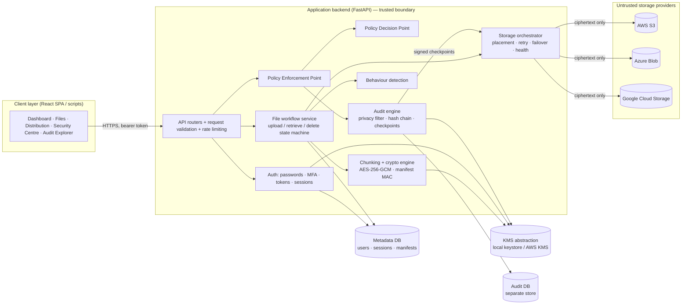
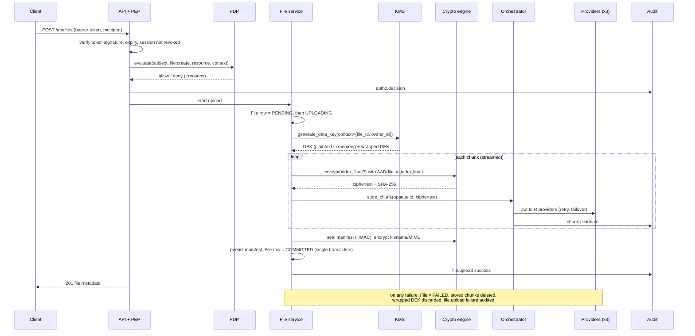

# Architecture

Zero-Trust Multi-Cloud Chunked Storage Framework with Privacy-Aware Audit Logging

## 1. Motivation: from the case study to requirements

The case study analyses the 2024 Snowflake customer-instance campaign (UNC5537).
Its central finding is that the attackers needed no exploit: a stolen password
was enough, and after login the platform's ordinary functions returned
plaintext. Encryption "was not defeated; it simply addressed a different threat
model" (§6.3, §11). The design below therefore treats **identity and
per-request authorisation as the gate in front of every key operation**, and
uses multi-cloud distribution so that one compromised provider credential
yields only ciphertext fragments.

| # | Case-study finding (section) | Requirement | Where implemented |
|---|---|---|---|
| R1 | Password-only authentication (§5.1, §5.2 stage 3) | Argon2id password hashing; TOTP MFA; sensitive actions require a recently MFA-verified session | `app/auth`, `app/policy` |
| R2 | Credentials valid for years (§5.2 stage 2) | 5-minute signed access tokens; single-use rotating refresh tokens with reuse detection; absolute and idle session lifetimes; server-side revocation checked on every request | `app/auth` |
| R3 | No network allow lists (§5.1) | Per-user CIDR allow list evaluated by the policy engine on every request | `app/policy` |
| R4 | Legitimate functions used for reconnaissance and bulk export (§5.3, §7.3) | Authorisation decision per operation, not per login; download-volume detection that raises alerts and blocks; no list-all capability across owners | `app/policy`, `app/detection` |
| R5 | Broad permissions amplified the breach (§6.2) | Least privilege: RBAC + ownership + classification/clearance ABAC; administrators cannot read file content | `app/policy` |
| R6 | Encryption could not stop an authenticated session (§6.3) | Keys are unwrapped only after an allow decision; provider credentials never give access to keys; key separation | `app/kms`, `app/cryptoengine`, `app/files` |
| R7 | Historical logs made investigation possible (§5.7, §6.4) | Tamper-evident, searchable audit log with signed checkpoints and retention controls | `app/audit` |
| R8 | Logs and data stores accumulate sensitive data (§6.2 retention, §9) | Pseudonymous actors, allow-listed audit fields, generalised IPs, configurable retention, crypto-shredding on delete | `app/audit`, `app/files` |
| R9 | Inconsistent controls across providers (§1.3, §7.1) | One policy enforcement point and one storage interface in front of all providers; uniform health and event collection | `app/storage`, `app/policy` |
| R10 | Layered controls, not substitutes (§9.1) | Preventive (authn/authz), limiting (least privilege, chunk distribution), detective (audit, anomaly detection) layers all present | whole system |

## 2. Component diagram



Trust boundaries: the backend process and the KMS are trusted. The three
storage providers, the network, the client, and (for integrity, not
confidentiality of metadata) the databases are treated as untrusted.

## 3. Data flow

### 3.1 Upload



### 3.2 Retrieval

```mermaid
sequenceDiagram
  participant C as Client
  participant A as API + PEP
  participant F as File service
  participant K as KMS
  participant O as Orchestrator
  participant S as Providers
  participant L as Audit
  C->>A: GET /api/files/{id}/download
  A->>A: authenticate + PDP(file:read) incl. ownership/share, clearance,<br/>MFA freshness, network, download-rate signals
  A->>L: authz.decision
  A->>F: retrieve
  F->>K: unwrap DEK (context must match file_id + owner_id)
  F->>F: verify manifest HMAC — abort if invalid
  loop each chunk in manifest order
    F->>O: fetch(chunk id, replicas, verify=SHA-256 matches manifest)
    O->>S: get from replica 1; on outage/missing/hash mismatch try replica 2
    F->>F: AES-GCM decrypt with AAD(file_id,index,final) — abort on failure
  end
  F->>F: verify whole-file SHA-256 and size
  F->>L: file.download success (or integrity failure, critical)
  A-->>C: plaintext only after ALL checks pass
```

Plaintext is released to the client only after every chunk and the whole-file
hash have verified, so a corrupted file is never partially delivered. The cost
is that a download is buffered server-side (spooled to an unlinked temporary
file above a memory threshold); see ADR-0005.

### 3.3 Chunk size, large files and deployment limits

* **Chunk size is a setting** (`ZT_CHUNK_SIZE_BYTES`, 1 byte to 64 MiB). The framework default is 1 MiB; the container deployment uses
  16 MiB. Every file's MAC-sealed manifest and database row record the chunk size the file was written with, and validation reads
  that value, so files written under different settings coexist and stay verifiable
  (`backend/tests/integration/app/test_large_files_and_chunk_sizes.py`).
* **Memory.** An upload is streamed: the splitter holds up to two chunks plus the copies made while encrypting, whatever the file
  size. Server memory stayed at 346 to 383 MiB for 2, 5 and 10 GiB files (`scripts/bench/results/phase2-20261125/big.json`).
* **Download spool.** A download is decrypted into a `SpooledTemporaryFile` (memory up to 8 MiB, then an unlinked file under
  `<data_dir>/tmp`), verified in full and only then released (ADR-0005). The data volume therefore needs room for the largest file
  per concurrent download, and the first byte arrives after the whole file is fetched and verified.
* **Limits that stop a large file, in order:** the nginx body limit, the application upload cap (`ZT_MAX_UPLOAD_BYTES`, default
  256 MiB), the bulk-download detector (a single download above `ZT_DETECT_MAX_DOWNLOAD_BYTES_IN_WINDOW`, default 512 MiB, is refused
  and the user blocked for 10 minutes), and the per-operation provider deadline, which must cover one chunk. The deployment values and
  their trade-offs are in ADR-0012 and `deploy/README.md`.

## 4. Module boundaries

| Package | Responsibility | Must not |
|---|---|---|
| `app/contracts.py` | Shared interfaces and value types | do I/O |
| `app/auth` | Password hashing, TOTP, access/refresh tokens, sessions, lockout | make authorisation decisions |
| `app/policy` | PDP (pure decision function), PEP (enforce + audit), policy settings | touch storage or keys |
| `app/kms` | Key hierarchy, wrap/unwrap, signing, rotation | know about files or users |
| `app/cryptoengine` | Chunking, per-chunk AEAD, manifest build/seal/verify, reassembly | talk to providers or DB |
| `app/storage` | Provider adapters, placement, retry, failover, health, fault injection | see plaintext or keys |
| `app/audit` | Privacy filter, pseudonyms, hash chain, checkpoints, verification, retention, search | depend on request state |
| `app/detection` | Download-pattern and auth-failure signals | block by itself (feeds PDP) |
| `app/files` | Upload/retrieve/delete/verify/repair state machine | bypass the PEP |
| `app/api` | HTTP routing, input validation, error mapping | contain business logic |

## 5. Technology selection

| Choice | Reason | Alternative considered |
|---|---|---|
| Python 3.11+ / FastAPI | First-party SDKs for all three clouds; `cryptography` gives audited AES-GCM, HKDF, Ed25519; fast to test | Go (stronger concurrency, slower to deliver a full UI + tests in scope) |
| SQLAlchemy 2, SQLite default, Postgres optional | Zero-setup local demo; same models run on Postgres by URL | Postgres only (needs a server for every test run) |
| Separate audit database | A metadata-DB compromise or rollback does not rewrite the audit trail | Same DB (simpler, weaker) |
| Argon2id (`argon2-cffi`) | Memory-hard, current OWASP recommendation | bcrypt |
| Ed25519-signed access tokens | Asymmetric: verifiers cannot mint tokens; no algorithm negotiation | HS256 shared secret |
| AES-256-GCM, HKDF-SHA256, HMAC-SHA256 | Standard primitives, no custom cryptography | XChaCha20-Poly1305 (equally fine; GCM was specified) |
| React + Vite + TypeScript | Typed API client, small build, no server-side rendering needed | Server-rendered templates |
| moto, Azurite, gcp-storage-emulator | Exercise the *real* boto3 / azure-storage-blob / google-cloud-storage SDKs locally without accounts | MinIO for all three (would test only the S3 API) |
| pytest | Unit, integration, security and emulator tests in one runner | — |

## 6. Directory structure

```
backend/app/{contracts,config,models,db,errors}.py   shared foundation
backend/app/{auth,policy,kms,cryptoengine,storage,audit,detection,files,api}/
backend/tests/{unit,integration,security,review}/
frontend/                      React SPA
scripts/                       emulator control, demo, attack simulations
deploy/                        Dockerfiles, docker-compose.yml
docs/                          architecture, threat model, ADRs, API, security testing, final report
```

## 7. Roadmap and verification criteria

| Phase | Deliverable | Verified by |
|---|---|---|
| 1 | This document, threat model, ADRs, contracts, skeleton | Skeleton imports; review |
| 2 | Auth, sessions, MFA, PDP/PEP | Unit tests: expiry, revocation, refresh reuse, lockout, every policy rule allow + deny |
| 3 | KMS, chunking, AEAD, manifest | Round-trip property tests; tamper, reorder, truncate, wrong-context tests; no providers involved |
| 4 | Three adapters, orchestrator | Same contract test suite run against memory + three emulators; outage, timeout, retry, failover tests |
| 5 | Audit chain, checkpoints, retention | Modify / delete / reorder / truncate detection tests; privacy filter tests |
| 6 | Integrated workflows and REST API | Integration tests incl. partial-failure cleanup and concurrency |
| 7 | Frontend | Builds; every view calls a live endpoint; manual smoke through the UI |
| 8 | Ten attack scenarios, failure scenarios, independent review | Automated security tests + demo script output |
| 9 | Documentation and final report | Full test run recorded verbatim in the report |
