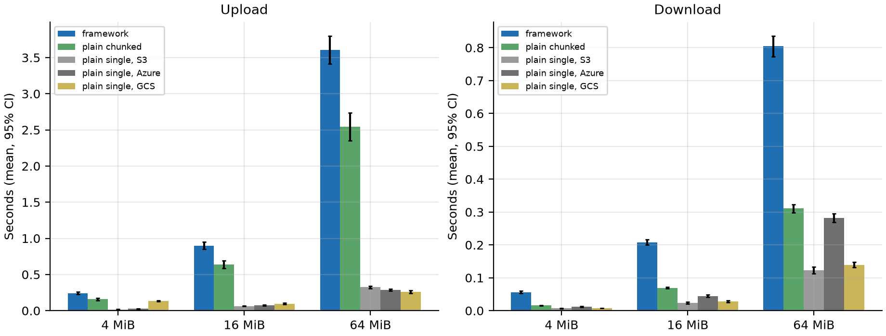
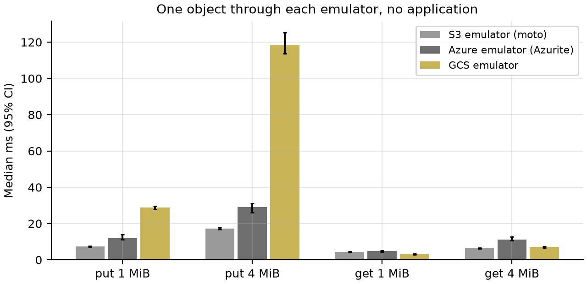
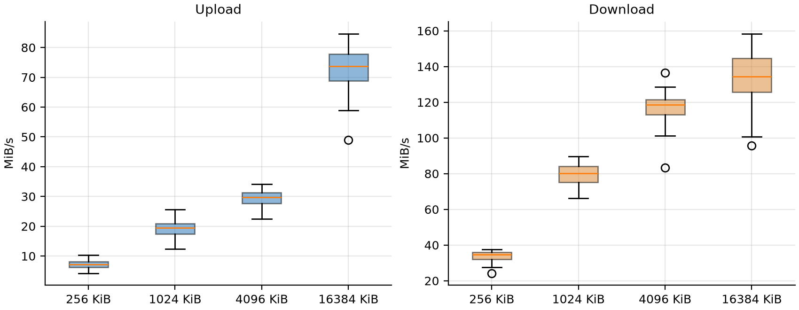
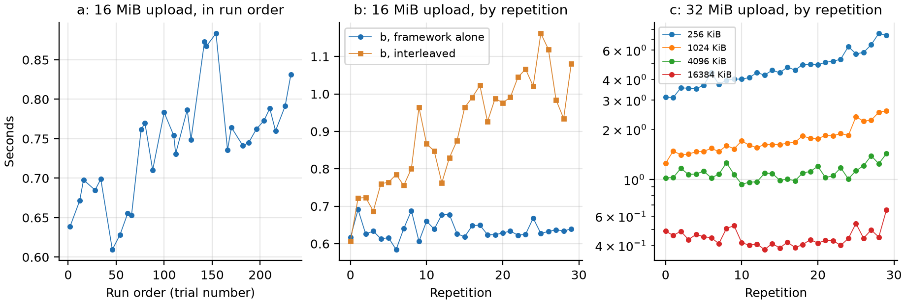
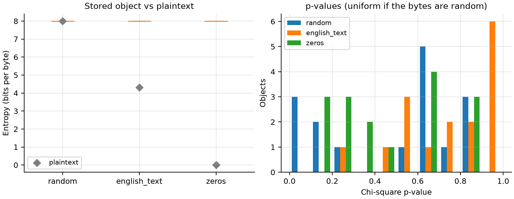

# Statistical analysis of the framework

## Key findings

* Time grows roughly linearly with size (R² 0.991 upload, 0.995 download; the rest is run-to-run scatter): the marginal rate is 21.6 MiB/s upload (95% CI 21.3 to 22.0) and 84.5 MiB/s download (95% CI 83.4 to 85.6).
* On these emulators the framework's 16 MiB upload takes 1.44 times the median of plain chunked storage of the same bytes (median difference 0.29 s, 95% bootstrap CI 0.13 to 0.41; Mann-Whitney p < 0.0001) and its download 3.03 times (median difference 0.14 s, CI 0.13 to 0.15). These ratios are not transferable: they are set by the emulators. A single 4 MiB object takes a median of 17 ms to write to the S3 emulator, 29 ms to the Azure emulator and 118 ms to the GCS emulator, so the slowest emulator for writes is the GCS emulator; a model that uses only the 1 MiB put latencies (each chunk waits for the slower of its two emulators) predicts the plain chunked upload time to within a factor of 1.74. AES-256-GCM with SHA-256 alone explains about 5% of the upload and 9% of the download difference.
* Chunk size matters: throughput differs between 256 KiB, 1, 4 and 16 MiB chunks (Kruskal-Wallis upload p < 0.0001, download p < 0.0001; eta squared 0.97 and 0.94); the best median upload is at 16384 KiB (73.7 MiB/s) against 7.2 MiB/s at 256 KiB.
* Run-order checks: 10 of 12 upload series show a significant trend with run order (Spearman p < 0.05) and 1 of 12 have a bimodality coefficient above 0.555; absolute times therefore carry run-to-run variation of the emulators and the machine, which is why comparisons are made only between arms interleaved inside one experiment.
* With one of three providers killed, 100/100 downloads and 100/100 uploads still succeeded (Wilson 95% lower bound 96.3% and 96.3%), and download latency changed measurably but little: the median moved by -12.3 ms (95% bootstrap CI -20.0 to -3.5; Mann-Whitney p 0.0006) and the mean by +32.5 ms, the mean being pulled up by a few slow requests (slowest 1.10 s against 0.29 s with all providers up); with two providers down 0/10 downloads succeeded, the documented limit of 2-way replication.
* Placement is balanced: replicas on the S3, Azure and GCS emulators were rotating 322 / 318 / 320 (chi-square 0.03, p 0.9876); hash 325 / 312 / 323 (chi-square 0.31, p 0.8580) (no evidence against uniformity).
* Stored objects look random whatever the plaintext: mean ciphertext entropy random 7.9998, english_text 7.9998, zeros 7.9998 bits per byte against plaintext entropy of 8.00, 4.31, 0.00; the chi-square test rejected uniformity for 1 of 48 objects; if every object were uniform at the 5% level, 2.4 rejections would be expected and P(X >= 1) = 0.91, so this is not unusual.
* Audit verification is linear: the log-log slope of time against events is 0.983 (95% CI 0.968 to 0.997; 1 means linear), R² 0.9969 for the linear fit (23.5 ms per 1000 events); `record()` sustains 871 events/s with an fsync per event.
* The security suite stopped or detected 108 of 108 designed attack and failure tests, none missed (Wilson 95% interval 96.6% to 100.0%; designed scenarios, not a random sample).
* The 1273-test suite covers 92.6% of the 8228 statements in backend/app (pytest-cov line coverage).

Everything in this report was measured by the scripts in `analysis/` on the machine described below, from the code at the commit shown. Raw data are in `analysis/data/*.csv`, figures in `analysis/figures/`, and `analysis/run_all.sh` reproduces all of it. No number was typed in by hand: they are computed from the CSV files by `analysis/analyze.py`.

## Environment and method

| Item | Value |
|---|---|
| Date | 2026-11-26T06:43:53+00:00 |
| Hardware | Intel(R) Core(TM) Ultra 9 185H, 22 logical CPUs, 15.3 GiB RAM |
| OS | Linux-6.18.33.2-microsoft-standard-WSL2-x86_64-with-glibc2.39 |
| Python / numpy / scipy / pandas / matplotlib | 3.12.3 / 2.5.5 / 1.18.1 / 3.1.1 / 3.11.2 |
| Git commit | 3a7ce89 (no uncommitted changes in backend/app; the later commits that add tests and documentation change no application code) |
| Random seed | 20261125 (order of conditions, bootstrap resampling) |
| Repetitions | n = 30 per condition after 3 discarded warm-up repetitions |
| Setting | three local emulators (moto S3, Azurite, gcp-storage-emulator) and the real boto3, azure-storage-blob and google-cloud-storage SDKs on one machine under WSL2; no network latency |
| Machine state | AC power connected (battery 100%), Windows High performance power plan, sleep disabled; laptop otherwise idle |
| Emulator state | stopped and restarted on an empty data directory before every experiment, so no experiment starts with objects left by another |

* **Statistics.** Per condition: n, mean, SD, median, 95% t-interval of the mean and 95% percentile-bootstrap interval of the median (5000 resamples). The tests were fixed before the data were looked at and do not depend on the data: two groups are compared with the Mann-Whitney U test (no normality assumption), with the difference of the medians and its 95% percentile-bootstrap interval (10000 resamples) as the effect size; Welch's t-test and the difference of the means are reported only as a secondary check in the data files. Several groups: Kruskal-Wallis, then pairwise Mann-Whitney with Holm correction. Proportions: Wilson 95% intervals; a binomial tail probability where a count is compared with an expected rate. Shapiro-Wilk p-values are shown only as a description of the shape of a distribution and never select a test.
* **Design.** Conditions were interleaved in a random order within each repetition, so slow or fast periods of the machine affect them alike. Successive requests to one server are not fully independent (caches, background threads); the interleaving reduces but does not remove that.
* **Honest limits.** Local emulators on one machine, no network latency, and the attack outcomes are designed scenarios, not a random sample. Absolute times are specific to this machine; ratios and shapes are the transferable part.

## a. Upload and download against file size

One real API server (1 MiB chunks, the framework default), files of 1, 4, 16 and 64 MiB, each uploaded and downloaded n times through the full stack (authentication, policy, KMS, encryption, replication to 2 of 3 emulators with read-back verification, audit). 0 of 240 transfers failed or did not verify; the rest are analysed.

**Time per transfer**

| Op | Size | n | Mean s | SD s | Median s | 95% CI of mean (s) | Mean MiB/s | Shapiro p (descriptive only) |
|---|---|---|---|---|---|---|---|---|
| upload | 1 MiB | 30 | 0.057 | 0.014 | 0.061 | [0.052, 0.062] | 18.5 | 0.084 |
| upload | 4 MiB | 30 | 0.203 | 0.028 | 0.199 | [0.193, 0.214] | 20.0 | 0.056 |
| upload | 16 MiB | 30 | 0.743 | 0.070 | 0.751 | [0.717, 0.770] | 21.7 | 0.487 |
| upload | 64 MiB | 30 | 2.970 | 0.217 | 2.996 | [2.889, 3.051] | 21.7 | 0.785 |
| download | 1 MiB | 30 | 0.021 | 0.004 | 0.020 | [0.020, 0.022] | 48.5 | 0.000 |
| download | 4 MiB | 30 | 0.053 | 0.005 | 0.052 | [0.051, 0.055] | 75.7 | 0.000 |
| download | 16 MiB | 30 | 0.200 | 0.017 | 0.201 | [0.194, 0.207] | 80.4 | 0.477 |
| download | 64 MiB | 30 | 0.766 | 0.039 | 0.764 | [0.751, 0.780] | 83.8 | 0.238 |

**Linear model: seconds = intercept + slope x size (ordinary least squares on all individual transfers)**

| Op | Slope s/MiB | 95% CI | Throughput MiB/s | 95% CI | Intercept s | 95% CI | R² |
|---|---|---|---|---|---|---|---|
| upload | 0.0462 | [0.0454, 0.0470] | 21.6 | [21.3, 22.0] | 0.012 | [-0.015, 0.039] | 0.9907 |
| download | 0.0118 | [0.0117, 0.0120] | 84.5 | [83.4, 85.6] | 0.009 | [0.003, 0.014] | 0.9950 |

*Time against file size with the fitted line (n = 30 per point, 1 MiB chunks).* ([PDF](../analysis/figures/a_scaling.pdf))

**What this shows.** Transfer time grows roughly linearly with file size (R² 0.99 upload, 0.99 download), so throughput is mostly a property of the pipeline rather than of the file size. The intercepts' confidence intervals include zero, so no fixed per-request cost is resolved at these sizes (the 1 MiB transfers are dominated by run-to-run scatter). Upload is much slower than download because every chunk is written to two providers and read back for verification. **Limitations.** Variance rises with size, so the least-squares standard errors are approximate and the linear fit leaves a good deal unexplained; emulators have no network latency; one machine.

**Log-log fit, log10 seconds = a + b log10 size (b = 1 means time proportional to size; with 1 MiB chunks the number of chunks equals the size in MiB, so size and chunk count cannot be separated here; experiment c varies the chunk count at a fixed size)**

| Op | log-log slope | 95% CI | R² |
|---|---|---|---|
| upload | 0.954 | [0.936, 0.972] | 0.990 |
| download | 0.875 | [0.858, 0.893] | 0.988 |

## b. Cost of security, and the emulators beneath it

### b1. What one emulator costs: put and get straight through each provider adapter

Before attributing any time to the framework, the three emulators were measured on their own: one object of 1 MiB or 4 MiB written and read straight through the application's own S3, Azure and GCS adapters (no application, no encryption), in random order, each object deleted afterwards. The latency of an emulator is a property of that emulator (a Python server for S3, a Node.js server for Azure, a Python server for GCS), not of the framework or of a real cloud.

**Latency of one object by emulator**

| Emulator | Size | Op | n | Median ms | 95% CI of median (ms) | Mean ms | SD ms | Median MiB/s |
|---|---|---|---|---|---|---|---|---|
| S3 emulator (moto) | 1 MiB | put | 30 | 7.4 | [7.2, 7.7] | 7.6 | 1.2 | 134.9 |
| Azure emulator (Azurite) | 1 MiB | put | 30 | 11.9 | [11.1, 13.8] | 13.2 | 3.5 | 84.3 |
| GCS emulator | 1 MiB | put | 30 | 28.8 | [27.8, 29.7] | 29.1 | 2.5 | 34.8 |
| S3 emulator (moto) | 4 MiB | put | 30 | 17.1 | [16.6, 17.8] | 17.8 | 2.1 | 233.6 |
| Azure emulator (Azurite) | 4 MiB | put | 30 | 29.1 | [26.1, 31.2] | 29.7 | 6.0 | 137.6 |
| GCS emulator | 4 MiB | put | 30 | 118.5 | [113.8, 125.3] | 120.3 | 9.8 | 33.8 |
| S3 emulator (moto) | 1 MiB | get | 30 | 4.3 | [4.2, 4.6] | 4.5 | 0.6 | 232.5 |
| Azure emulator (Azurite) | 1 MiB | get | 30 | 4.7 | [4.3, 5.1] | 5.0 | 1.1 | 211.4 |
| GCS emulator | 1 MiB | get | 30 | 3.0 | [2.8, 3.2] | 3.2 | 0.6 | 332.0 |
| S3 emulator (moto) | 4 MiB | get | 30 | 6.4 | [6.1, 6.6] | 6.4 | 0.7 | 629.6 |
| Azure emulator (Azurite) | 4 MiB | get | 30 | 11.1 | [10.6, 12.8] | 12.2 | 2.7 | 359.4 |
| GCS emulator | 4 MiB | get | 30 | 7.0 | [6.7, 7.3] | 7.5 | 1.6 | 571.2 |

**Do the three emulators differ in latency?**

| Op | Size | Kruskal-Wallis H (2 df) | p |
|---|---|---|---|
| put | 1 MiB | 77.5 | < 0.0001 |
| put | 4 MiB | 78.9 | < 0.0001 |
| get | 1 MiB | 50.9 | < 0.0001 |
| get | 4 MiB | 63.6 | < 0.0001 |

**Predicting the plain chunked upload from the 1 MiB put latencies alone (each chunk waits for the slower of its two providers)**

| Size | Predicted plain chunked upload (s) | Measured plain chunked upload, median (s) | Measured / predicted | Framework upload, median (s) |
|---|---|---|---|---|
| 4 MiB | 0.09 | 0.15 | 1.62 | 0.24 |
| 16 MiB | 0.37 | 0.64 | 1.74 | 0.93 |
| 64 MiB | 1.48 | 2.55 | 1.73 | 3.70 |

The slowest emulator for writes is the GCS emulator (median 118 ms for a 4 MiB object, against 17 ms for the S3 emulator (moto)). Every chunk is written to two of the three emulators in parallel, so uploads wait for the slower of the two. The model above, which uses nothing but the 1 MiB put latencies, comes within a factor of 1.7 of the measured plain chunked time and under-predicts it (the measured time also contains per-call SDK overhead and thread hand-offs that one put does not), so the emulators' own latency is the main part of the plain chunked upload time, but not the only part.

### b2. The same bytes with and without the security pipeline

The same bytes stored five ways, against the same emulators and through the same provider adapters: **app** = the full framework; **plain chunked** = a harness outside the application that splits the file into 1 MiB chunks and writes each plain chunk to 2 of the 3 providers in parallel (rotating placement), with no encryption, manifest, database, policy, audit or read-back verification; **plain single (S3 / Azure / GCS)** = one object to one provider, measured separately for each emulator. The plain arms are the cheapest possible storage of these bytes; the difference to the app is the price of the whole security pipeline on these emulators, not of encryption alone.

**Time per transfer by arm**

| Op | Size | Arm | n | Mean s | SD s | Median s | 95% CI of mean (s) |
|---|---|---|---|---|---|---|---|
| upload | 4 MiB | framework | 30 | 0.242 | 0.043 | 0.241 | [0.226, 0.258] |
| upload | 4 MiB | plain chunked | 30 | 0.160 | 0.044 | 0.150 | [0.143, 0.176] |
| upload | 4 MiB | plain single, S3 | 30 | 0.018 | 0.003 | 0.017 | [0.017, 0.019] |
| upload | 4 MiB | plain single, Azure | 30 | 0.025 | 0.005 | 0.025 | [0.023, 0.027] |
| upload | 4 MiB | plain single, GCS | 30 | 0.135 | 0.013 | 0.135 | [0.130, 0.140] |
| upload | 16 MiB | framework | 30 | 0.901 | 0.141 | 0.930 | [0.848, 0.953] |
| upload | 16 MiB | plain chunked | 30 | 0.637 | 0.141 | 0.645 | [0.584, 0.689] |
| upload | 16 MiB | plain single, S3 | 30 | 0.064 | 0.006 | 0.063 | [0.062, 0.066] |
| upload | 16 MiB | plain single, Azure | 30 | 0.075 | 0.012 | 0.072 | [0.071, 0.080] |
| upload | 16 MiB | plain single, GCS | 30 | 0.098 | 0.028 | 0.107 | [0.087, 0.108] |
| upload | 64 MiB | framework | 30 | 3.607 | 0.519 | 3.695 | [3.413, 3.800] |
| upload | 64 MiB | plain chunked | 30 | 2.544 | 0.520 | 2.555 | [2.350, 2.738] |
| upload | 64 MiB | plain single, S3 | 30 | 0.326 | 0.044 | 0.328 | [0.310, 0.343] |
| upload | 64 MiB | plain single, Azure | 30 | 0.288 | 0.037 | 0.288 | [0.274, 0.301] |
| upload | 64 MiB | plain single, GCS | 30 | 0.258 | 0.056 | 0.248 | [0.237, 0.279] |
| download | 4 MiB | framework | 30 | 0.056 | 0.008 | 0.054 | [0.053, 0.059] |
| download | 4 MiB | plain chunked | 30 | 0.016 | 0.002 | 0.016 | [0.016, 0.017] |
| download | 4 MiB | plain single, S3 | 30 | 0.007 | 0.001 | 0.007 | [0.007, 0.007] |
| download | 4 MiB | plain single, Azure | 30 | 0.012 | 0.004 | 0.010 | [0.010, 0.013] |
| download | 4 MiB | plain single, GCS | 30 | 0.007 | 0.001 | 0.007 | [0.007, 0.008] |
| download | 16 MiB | framework | 30 | 0.208 | 0.021 | 0.207 | [0.200, 0.216] |
| download | 16 MiB | plain chunked | 30 | 0.069 | 0.006 | 0.068 | [0.067, 0.072] |
| download | 16 MiB | plain single, S3 | 30 | 0.023 | 0.007 | 0.022 | [0.021, 0.026] |
| download | 16 MiB | plain single, Azure | 30 | 0.045 | 0.009 | 0.042 | [0.042, 0.048] |
| download | 16 MiB | plain single, GCS | 30 | 0.028 | 0.009 | 0.026 | [0.025, 0.031] |
| download | 64 MiB | framework | 30 | 0.805 | 0.084 | 0.784 | [0.773, 0.836] |
| download | 64 MiB | plain chunked | 30 | 0.311 | 0.032 | 0.311 | [0.299, 0.323] |
| download | 64 MiB | plain single, S3 | 30 | 0.123 | 0.026 | 0.119 | [0.113, 0.133] |
| download | 64 MiB | plain single, Azure | 30 | 0.283 | 0.035 | 0.275 | [0.269, 0.296] |
| download | 64 MiB | plain single, GCS | 30 | 0.140 | 0.022 | 0.134 | [0.131, 0.148] |

**Framework against plain chunked storage (six comparisons; primary test fixed in advance: Mann-Whitney U, effect size = difference of medians with a bootstrap interval)**

| Op | Size | Median: framework minus plain chunked (s) | 95% bootstrap CI | Ratio of medians | Mann-Whitney p | p (Holm) | Cliff delta |
|---|---|---|---|---|---|---|---|
| upload | 4 MiB | 0.091 | [0.050, 0.122] | 1.61 | < 0.0001 | < 0.0001 | 0.82 |
| upload | 16 MiB | 0.286 | [0.133, 0.410] | 1.44 | < 0.0001 | < 0.0001 | 0.80 |
| upload | 64 MiB | 1.140 | [0.539, 1.582] | 1.45 | < 0.0001 | < 0.0001 | 0.85 |
| download | 4 MiB | 0.038 | [0.035, 0.041] | 3.34 | < 0.0001 | < 0.0001 | 1.00 |
| download | 16 MiB | 0.138 | [0.126, 0.145] | 3.03 | < 0.0001 | < 0.0001 | 1.00 |
| download | 64 MiB | 0.473 | [0.448, 0.513] | 2.52 | < 0.0001 | < 0.0001 | 1.00 |

**The same comparison at the start and at the end of the run (medians of the first and last 10 repetitions): both arms change during the run, so the ratio is not constant**

| Op | Size | Framework, first third (s) | Plain chunked, first third (s) | Ratio | Framework, last third (s) | Plain chunked, last third (s) | Ratio |
|---|---|---|---|---|---|---|---|
| upload | 4 MiB | 0.201 | 0.111 | 1.81 | 0.276 | 0.200 | 1.38 |
| upload | 16 MiB | 0.758 | 0.477 | 1.59 | 1.033 | 0.801 | 1.29 |
| upload | 64 MiB | 2.983 | 1.928 | 1.55 | 4.047 | 3.059 | 1.32 |
| download | 4 MiB | 0.054 | 0.017 | 3.16 | 0.051 | 0.016 | 3.26 |
| download | 16 MiB | 0.202 | 0.069 | 2.93 | 0.208 | 0.067 | 3.09 |
| download | 64 MiB | 0.763 | 0.315 | 2.43 | 0.798 | 0.303 | 2.64 |

**CPU cost of the cipher itself (the same calls the application makes, 16 MiB per repetition)**

| Cipher alone, no I/O | n | Mean ms per MiB | SD | 95% CI | MiB/s |
|---|---|---|---|---|---|
| encrypt (AES-256-GCM + SHA-256) | 30 | 0.805 | 0.035 | [0.792, 0.818] | 1242 |
| decrypt (SHA-256 check + AES-256-GCM) | 30 | 0.744 | 0.032 | [0.732, 0.756] | 1344 |

### b3. Why the framework's 16 MiB upload differs between experiments a and b

**The same measurement taken three ways**

| Series (framework, 16 MiB upload, 1 MiB chunks) | n | Mean s | SD s | Median s |
|---|---|---|---|---|
| experiment a (fresh emulators, framework only, four sizes interleaved) | 30 | 0.743 | 0.070 | 0.751 |
| experiment b, isolated block (fresh emulators, framework only, 16 MiB) | 30 | 0.637 | 0.024 | 0.633 |
| experiment b, interleaved with the plain arms (fresh emulators) | 30 | 0.901 | 0.141 | 0.930 |

**Pairwise comparison (three comparisons, Holm-adjusted)**

| Comparison | Median difference (s) | 95% bootstrap CI | Mann-Whitney p | p (Holm) |
|---|---|---|---|---|
| b isolated minus a | -0.118 | [-0.137, -0.087] | < 0.0001 | < 0.0001 |
| b interleaved minus b isolated | 0.297 | [0.180, 0.354] | < 0.0001 | < 0.0001 |
| b interleaved minus a | 0.179 | [0.061, 0.243] | < 0.0001 | < 0.0001 |

**Reading.** The three series are the same measurement (the framework, 16 MiB upload, 1 MiB chunks, freshly started emulators), but their medians are 0.75 s (experiment a), 0.63 s (b, framework alone) and 0.93 s (b, interleaved), and every pair differs (all Holm p < 0.05). Within each series, upload time changes as the run goes on: Spearman rho +0.71 in a, +0.13 for the framework alone in b and +0.89 interleaved in b; the median of the first third of the trials against the last third is 0.66 s against 0.76 s in a, 0.62 s against 0.63 s alone in b and 0.76 s against 1.03 s interleaved in b. Both arms of the interleaved block slow down as the run goes on: the 16 MiB upload takes 0.76 s then 1.03 s for the framework and 0.48 s then 0.80 s for plain chunked storage (first and last third of the repetitions), so the ratio moves from 1.59 to 1.29; downloads show no such drift. The plain arm deletes its objects after every trial and still slows down, so a growing number of stored objects does not explain it by itself. The cause (emulator internals, disk state or machine state) was not identified. Switching the laptop to AC power and a high-performance plan did not remove the drift. The consequences are that absolute times from different experiments must not be compared, that the ratios of experiment b are averages over a comparison that changes during the run, and that only arms interleaved inside one experiment can be compared at all.

*Mean time with 95% confidence intervals: the framework, plain chunked storage and a plain single object on each emulator.* ([PDF](../analysis/figures/b_overhead.pdf))

*Median latency of one object straight through each provider adapter, by emulator.* ([PDF](../analysis/figures/b_providers.pdf))

**What this shows.** The three emulators are very different from one another, and uploads wait for the slower emulator of each chunk's pair, so most of an upload's time is emulator time. The framework is slower than plain chunked storage at every size (largest Holm-adjusted p < 0.0001); the cipher itself is a small part of the difference and the remainder was not decomposed (HTTP request handling, metadata commits, audit events, policy checks, read-back verification and spooling). **Limitations.** The ratios between the framework and plain storage depend on the speed of the emulators: with faster or slower providers they would be different, so they are not transferable and no real-cloud claim is made. The plain arms are a lower bound (they do not authenticate, authorise, log or verify).

## c. Effect of chunk size

A 32 MiB file through four servers that differ only in chunk size (256 KiB, 1 MiB, 4 MiB, 16 MiB), interleaved in random order.

**Throughput by chunk size**

| Op | Chunk | n | Mean MiB/s | SD | Median | 95% CI of mean | Shapiro p (descriptive only) |
|---|---|---|---|---|---|---|---|
| upload | 256 KiB | 30 | 7.2 | 1.6 | 7.2 | [6.6, 7.8] | 0.883 |
| upload | 1024 KiB | 30 | 18.9 | 3.2 | 19.5 | [17.7, 20.1] | 0.221 |
| upload | 4096 KiB | 30 | 29.4 | 2.9 | 29.7 | [28.3, 30.5] | 0.321 |
| upload | 16384 KiB | 30 | 72.5 | 7.9 | 73.7 | [69.5, 75.4] | 0.106 |
| download | 256 KiB | 30 | 33.9 | 3.2 | 34.6 | [32.7, 35.1] | 0.006 |
| download | 1024 KiB | 30 | 79.6 | 5.8 | 80.3 | [77.4, 81.8] | 0.460 |
| download | 4096 KiB | 30 | 116.9 | 10.1 | 118.5 | [113.1, 120.6] | 0.024 |
| download | 16384 KiB | 30 | 132.5 | 16.1 | 134.5 | [126.5, 138.5] | 0.203 |

**Does throughput depend on chunk size? (3 degrees of freedom)**

| Op | ANOVA F | ANOVA p | Kruskal-Wallis H | KW p | Primary | Eta squared |
|---|---|---|---|---|---|---|
| upload | 1167.0 | < 0.0001 | 111.3 | < 0.0001 | Kruskal-Wallis (fixed in advance) | 0.968 |
| download | 572.9 | < 0.0001 | 104.0 | < 0.0001 | Kruskal-Wallis (fixed in advance) | 0.937 |

**Pairwise Mann-Whitney U tests**

| Op | Pair | Median ratio (second/first) | p | p (Holm) |
|---|---|---|---|---|
| upload | 256 vs 1024 KiB | 2.73 | < 0.0001 | < 0.0001 |
| upload | 256 vs 4096 KiB | 4.16 | < 0.0001 | < 0.0001 |
| upload | 256 vs 16384 KiB | 10.30 | < 0.0001 | < 0.0001 |
| upload | 1024 vs 4096 KiB | 1.52 | < 0.0001 | < 0.0001 |
| upload | 1024 vs 16384 KiB | 3.77 | < 0.0001 | < 0.0001 |
| upload | 4096 vs 16384 KiB | 2.48 | < 0.0001 | < 0.0001 |
| download | 256 vs 1024 KiB | 2.32 | < 0.0001 | < 0.0001 |
| download | 256 vs 4096 KiB | 3.42 | < 0.0001 | < 0.0001 |
| download | 256 vs 16384 KiB | 3.89 | < 0.0001 | < 0.0001 |
| download | 1024 vs 4096 KiB | 1.48 | < 0.0001 | < 0.0001 |
| download | 1024 vs 16384 KiB | 1.67 | < 0.0001 | < 0.0001 |
| download | 4096 vs 16384 KiB | 1.14 | < 0.0001 | < 0.0001 |

**Time against the number of chunks (the same 32 MiB file cut into 2 to 128 chunks): the cost of one more chunk**

| Op | Seconds per extra chunk | 95% CI | Intercept s | R² |
|---|---|---|---|---|
| upload | 0.0319 | [0.0298, 0.0341] | 0.641 | 0.875 |
| download | 0.0056 | [0.0054, 0.0058] | 0.230 | 0.960 |

*Throughput by chunk size for a 32 MiB file (n = 30 per box).* ([PDF](../analysis/figures/c_chunk.pdf))

**What this shows.** Larger chunks raise throughput: the median goes up with every step for uploads (the last step, 4096 to 16384 KiB, is still a factor 2.48), while downloads flatten out between 4096 and 16384 KiB (factor 1.14). Fewer chunks mean fewer provider requests and database rows for the same bytes. **Limitations.** One file size; emulators have no per-request network latency, which on real providers would favour larger chunks even more; a chunk is also the unit of retry and repair, which this experiment does not measure.

## Run order, drift and bimodality

Every timed trial carries its position in the run. If the machine or an emulator slowed down or sped up during an experiment, time would trend with run order; if two modes were present (for example one provider pair being slower), the histogram would have two humps. For each series: the Spearman correlation between run order and time, and the bimodality coefficient BC = (skewness² + 1) / (excess kurtosis + 3(n−1)² / ((n−2)(n−3))), where BC above 0.555 (the value for a uniform distribution) suggests more than one mode.

**Drift and bimodality checks**

| Series | n | Spearman rho (run order, time) | p | Median, first third (s) | Median, last third (s) | Bimodality coefficient | BC > 0.555 |
|---|---|---|---|---|---|---|---|
| a: framework upload, 1 MiB | 30 | +0.44 | 0.0158 | 0.049 | 0.065 | 0.39 | no |
| a: framework upload, 4 MiB | 30 | +0.52 | 0.0036 | 0.182 | 0.200 | 0.47 | no |
| a: framework upload, 16 MiB | 30 | +0.71 | < 0.0001 | 0.663 | 0.763 | 0.32 | no |
| a: framework upload, 64 MiB | 30 | +0.76 | < 0.0001 | 2.769 | 3.062 | 0.33 | no |
| b: framework upload alone, 16 MiB | 30 | +0.13 | 0.4960 | 0.621 | 0.633 | 0.37 | no |
| b: framework upload interleaved, 4 MiB | 30 | +0.71 | < 0.0001 | 0.201 | 0.276 | 0.48 | no |
| b: framework upload interleaved, 16 MiB | 30 | +0.89 | < 0.0001 | 0.758 | 1.033 | 0.41 | no |
| b: framework upload interleaved, 64 MiB | 30 | +0.89 | < 0.0001 | 2.983 | 4.047 | 0.53 | no |
| c: upload, 32 MiB, 256 KiB chunks | 30 | +0.98 | < 0.0001 | 3.619 | 5.754 | 0.48 | no |
| c: upload, 32 MiB, 1024 KiB chunks | 30 | +0.97 | < 0.0001 | 1.471 | 2.067 | 0.59 | yes |
| c: upload, 32 MiB, 4096 KiB chunks | 30 | +0.39 | 0.0347 | 1.073 | 1.187 | 0.51 | no |
| c: upload, 32 MiB, 16384 KiB chunks | 30 | -0.06 | 0.7605 | 0.463 | 0.442 | 0.54 | no |

**Does the number of replicas a file puts on each emulator explain its upload time? (16 chunks, 32 replicas per file; the S3 count is the remainder)**

| Series | n | Seconds per extra replica on Azure (CI) | Seconds per extra replica on GCS (CI) | R² |
|---|---|---|---|---|
| a, 16 MiB upload | 30 | +0.040 [-0.019, 0.100] | +0.056 [-0.009, 0.121] | 0.115 |
| b, 16 MiB upload, interleaved | 30 | +0.151 [0.030, 0.271] | +0.071 [-0.049, 0.192] | 0.196 |

*Upload times in run order for experiments a, b and c (a straight line would mean no drift).* ([PDF](../analysis/figures/run_order.pdf))

**What this shows.** The table lists, for every upload series, whether time drifted during the run and whether its distribution has more than one mode. Series with drift or two modes are the reason the report compares conditions only when they were interleaved in random order within one experiment. **Limitations.** Spearman correlation detects a monotone trend only; the bimodality coefficient is a rough indicator at n = 30; the replica-count regression has few distinct counts to work with because rotating placement is balanced by design.

## d. Fault tolerance: a real emulator outage

The gcs-storage emulator process was killed with `scripts/emulators.sh stop-one gcs` while a file uploaded before the outage was downloaded repeatedly and new files were uploaded. Then a second emulator (Azurite) was stopped to show the limit of 2-way replication, and both were restarted.

**Download latency (16 MiB file, 1 MiB chunks)**

| Condition | n | Mean s | SD s | Median s | Note |
|---|---|---|---|---|---|
| download, all providers up | 30 | 0.213 | 0.018 | 0.210 | - |
| download, gcs down (trials 4 to 33) | 30 | 0.245 | 0.192 | 0.198 | - |
| download, gcs down, first 3 trials after the outage | 3 | 0.336 | - | 0.253 | failover and breaker adapting |

**Does one provider down change steady-state download latency?**

| Comparison | Median difference (ms) | 95% bootstrap CI (ms) | Ratio of medians | Mann-Whitney p | Mean difference (ms) | Cliff delta |
|---|---|---|---|---|---|---|
| gcs down minus all up | -12.3 | [-20.0, -3.5] | 0.941 | 0.0006 | 32.5 | -0.52 |

**Success rates**

| Scenario | Trials | Successes | Success rate | Wilson 95% CI |
|---|---|---|---|---|
| downloads, 1 provider down | 100 | 100 | 100.0% | [96.3%, 100.0%] |
| uploads, 1 provider down | 100 | 100 | 100.0% | [96.3%, 100.0%] |
| downloads, 2 providers down | 10 | 0 | 0.0% | [0.0%, 27.8%] |
| downloads after restart | 5 | 5 | 100.0% | [56.6%, 100.0%] |

Placement during the outage: replicas of the files uploaded while gcs was down: `{"aws-s3": 400, "azure-blob": 400}` (0 on gcs). After the emulators were restarted the first good download came 2.2 s later.

*Download latency with and without one provider, and success rates with Wilson intervals.* ([PDF](../analysis/figures/d_fault.pdf))

**What this shows.** A real outage of one provider does not stop reads or writes (reads fail over to the surviving replica, writes are placed on the other providers). With one provider down, download latency changed measurably but little: the median moved by -12.3 ms (95% bootstrap CI -20.0 to -3.5; Mann-Whitney p 0.0006) and the mean by +32.5 ms, the mean being pulled up by a few slow requests (slowest 1.10 s against 0.29 s with all providers up). With two providers down, reads fail for chunks whose two replicas were both on them, as designed. **Limitations.** The emulator refuses connections immediately, so detection was instant. A provider that hangs would be detected only after the provider timeout, which is 10 s by default in the framework, 30 s in the container deployment settings and 600 s in this measurement setup (raised so that slow emulator transfers never time out); a hanging provider was not tested. One outage pattern.

## e. Placement balance

60 uploads of an 8 MiB file (480 chunks, 960 replicas) per placement strategy; replicas counted from the metadata database. Null hypothesis: replicas are spread uniformly over the three providers. Chunks of one file are not independent draws, so the p-values are approximate.

**Replicas per provider and chi-square goodness of fit against uniform**

| Strategy | S3 emulator | Azure emulator | GCS emulator | Expected each | chi2 (2 df) | p | Chunks per provider pair | chi2 pairs | p pairs |
|---|---|---|---|---|---|---|---|---|---|
| rotating | 322 | 318 | 320 | 320.0 | 0.03 | 0.9876 | 160/162/158 | 0.05 | 0.9753 |
| hash | 325 | 312 | 323 | 320.0 | 0.31 | 0.8580 | 157/168/155 | 0.61 | 0.7362 |

*Replicas per provider for the two placement strategies against a uniform expectation.* ([PDF](../analysis/figures/e_placement.pdf))

**What this shows.** Neither strategy concentrates chunks on one provider, so a single provider holds about two thirds of the chunks and none holds all. **Limitations.** A non-rejected chi-square test is absence of evidence of imbalance, not proof of uniformity; chunks within a file are dependent; the rotating strategy is balanced by construction.

## f. Ciphertext randomness at the providers

Objects were read raw from the emulators through each provider's own SDK, exactly as a holder of a provider credential would see them, for 16 MiB files of random bytes, English text and zeros. For each stored object: Shannon entropy in bits per byte and a chi-square test of the byte frequencies against uniform (255 degrees of freedom). Replicas of one chunk are the same bytes and are counted once.

**Entropy and byte-frequency tests of the stored objects**

| Plaintext | Objects | Plaintext entropy (bits/byte) | Ciphertext entropy mean | SD | Chi-square rejections at 0.05 | Wilson 95% of rate | KS p of p-values vs uniform |
|---|---|---|---|---|---|---|---|
| random | 16 | 7.9998 | 7.99982 | 0.00002 | 1/16 | [1.1%, 28.3%] | 0.6403 |
| english_text | 16 | 4.3141 | 7.99984 | 0.00001 | 0/16 | [0.0%, 19.4%] | 0.0049 |
| zeros | 16 | 0.0000 | 7.99982 | 0.00001 | 0/16 | [0.0%, 19.4%] | 0.7955 |

*Entropy of stored ciphertext against plaintext, and the distribution of chi-square p-values.* ([PDF](../analysis/figures/f_entropy.pdf))

**Is the number of rejections unusual?** With 48 independent objects and a 5% level, 2.4 rejections are expected by chance; 1 were observed, and the probability of 1 or more under that assumption is P(X >= 1) = 0.91 (binomial). That is not evidence of non-randomness.

**What this shows.** A provider that reads its own objects sees data statistically indistinguishable from random bytes, even when the plaintext is all zeros. **Limitations.** Passing these tests is necessary, not sufficient, for security (the guarantee comes from AES-256-GCM, not from the tests); object sizes, counts and timing remain visible to a provider.

## g. Audit log: verification scaling and write throughput

Events were written to a fresh hash-chained audit log (each one fsynced), and `verify_chain` (hash chain, signed checkpoints and anchors) was timed at each size.

**verify_chain time**

| Events | n | Mean s | SD s | Median s | 95% CI of mean | Chain valid |
|---|---|---|---|---|---|---|
| 1003 | 10 | 0.0262 | 0.0026 | 0.0251 | [0.0244, 0.0281] | 10/10 |
| 2003 | 10 | 0.0467 | 0.0018 | 0.0465 | [0.0454, 0.0480] | 10/10 |
| 5003 | 10 | 0.1166 | 0.0056 | 0.1169 | [0.1126, 0.1206] | 10/10 |
| 10003 | 10 | 0.2385 | 0.0257 | 0.2283 | [0.2201, 0.2569] | 10/10 |
| 20003 | 10 | 0.4691 | 0.0360 | 0.4576 | [0.4433, 0.4949] | 10/10 |
| 50003 | 10 | 1.1762 | 0.0361 | 1.1861 | [1.1503, 1.2020] | 10/10 |

**Is verification linear in the number of events? (a log-log slope of 1 means linear)**

| Model | Slope | 95% CI | Intercept | R² |
|---|---|---|---|---|
| seconds = a + b x events | 23.5 ms per 1000 events (0.0235 ms per event) | [23.2, 23.8] ms per 1000 events | 0.0008 s | 0.9969 |
| log10 seconds = a + b log10 events | 0.983 | [0.968, 0.997] | -4.556 | 0.9968 |

`record()` throughput over 50000 events: mean 871 events/s (SD 29, 95% CI of the mean 863 to 880); trend against log size +0.076 events/s per 1000 events (95% CI -0.505 to +0.657, p 0.7929).

*verify_chain time against log size with a linear fit, and record() throughput as the log grows.* ([PDF](../analysis/figures/g_audit.pdf))

**What this shows.** Verifying the whole log costs time proportional to its length, and no trend in the write rate is detectable as the log grows (the confidence interval of the trend includes zero), so the audit log can be checked routinely. **Limitations.** Memory-backed providers hold the anchors here, SQLite on one disk; a PostgreSQL deployment was not measured; the per-event fsync cost depends on the disk.

## h. Detection of attacks and tampering

Outcomes of the security suite (`scripts/attacks/run_all.sh`): each row is one designed attack or failure scenario with its observed result and audit record. **This is a table of designed scenarios, not a random sample of attacks**, so the intervals below say how well the suite supports the claim, not what an unknown attacker would achieve.

**Scenarios (S = attack, E = provider failure)**

| Scenario | Attack or failure (first test) | Tests passed |
|---|---|---|
| E01 | Kill the gcp-storage-emulator process (real outage) | 1/1 |
| E02 | Delete every Azure copy of a file's chunks via the Azure SDK | 1/1 |
| E03 | Overwrite every S3 copy of a file's chunks via boto3 with same-size garbage | 1/1 |
| E04 | Every call to Azure times out (fault mode 'timeout' over the real SDK adapter) | 1/1 |
| E05 | GCS fails the next 2 calls (fault mode fail-n) during upload | 1/1 |
| E06 | Delete one chunk at EVERY provider holding it (via each SDK) | 1/1 |
| E07 | GCS down AND the other replica of some chunks lost; GCS comes back | 1/1 |
| S01 | Forge a token with alg=none (algorithm confusion) | 8/8 |
| S02 | Use a still-valid token whose session has been idle > 30 min | 3/3 |
| S03 | bob keeps using alice's file after alice revokes the share | 10/10 |
| S04 | Admin (fresh MFA) downloads / deletes / shares a user's file | 4/4 |
| S05 | Flip one bit in BOTH replicas of one chunk | 3/3 |
| S06 | Set files.owner_id to the attacker's user id in the metadata DB | 6/6 |
| S07 | Swap chunks 0/1 AND re-seal a consistent manifest (simulated MAC-key compromise) | 5/5 |
| S08 | Two deployments (different keystores) write checkpoints at the same seq into one shared bucket | 11/11 |
| S09 | With provider A's credential: delete-everything (chunks AND audit anchors) | 4/4 |
| S10 | Try one leaked password against 6 different usernames from one /24 | 7/7 |
| S11 | Stolen password (account inside the TOFU window): enrol + activate own TOTP, then download a confidential file | 6/6 |
| S12 | Token of a session opened inside the allow list used from outside for password change and MFA enrol/activate/verify/disable | 3/3 |
| S13 | Valid session downloads every file in a loop (bulk export) | 2/2 |
| S14 | Thief replays a refresh token the legitimate client already rotated | 2/2 |
| S15 | Admin disables alice / demotes an auditor while their tokens are still unexpired | 2/2 |
| S16 | Filename with quotes/CRLF/;/<script> to break Content-Disposition or inject HTML | 23/23 |
| S17 | Check every stored event: actor format, no _dropped detail keys | 2/2 |

**Confusion-style summary**

| Attempts (tests) | Stopped or detected | Missed | Rate | Wilson 95% CI |
|---|---|---|---|---|
| 108 | 108 | 0 | 100.0% | [96.6%, 100.0%] |

*Number of tests per attack or failure scenario (108 of 108 passed).* ([PDF](../analysis/figures/h_attacks.pdf))

**What this shows.** Every designed scenario ended in a block, a detection or a documented limit, with an audit record. **Limitations.** A passing suite shows the checks work for the scenarios someone thought of; it says nothing about unknown ones, and no external penetration test was done.

## i. Engineering metrics

**Lines of Python per module (code = not blank, not comment-only)**

| Module (backend/app) | Lines | Code lines |
|---|---|---|
| storage | 2680 | 2258 |
| audit | 1956 | 1609 |
| auth | 1875 | 1574 |
| api | 1830 | 1436 |
| (top level) | 1523 | 1182 |
| kms | 1160 | 951 |
| files | 962 | 851 |
| cryptoengine | 911 | 738 |
| policy | 671 | 549 |
| admin | 287 | 243 |
| detection | 279 | 238 |
| TOTAL | 14134 | 11629 |

**Lines by area**

| Area | Lines | Code lines |
|---|---|---|
| analysis | 2006 | 1719 |
| backend/app | 14134 | 11629 |
| backend/tests | 11850 | 9456 |
| frontend/src | 4698 | 4368 |
| scripts | 3595 | 2991 |

**Tests by category (pytest --collect-only)**

| Test category | Tests |
|---|---|
| integration | 155 |
| review | 42 |
| security | 108 |
| unit | 968 |
| TOTAL | 1273 |

**Tests by module**

| Category | Module | Tests |
|---|---|---|
| integration | app | 77 |
| integration | storage | 78 |
| review | test_review_audit | 7 |
| review | test_review_auth | 28 |
| review | test_review_input_config | 7 |
| security | test_e01_provider_failures | 7 |
| security | test_s01_s02_authentication | 11 |
| security | test_s03_s04_authorization | 14 |
| security | test_s05_s07_data_integrity | 14 |
| security | test_s08_audit_tampering | 11 |
| security | test_s09_provider_compromise | 4 |
| security | test_s10_brute_force | 7 |
| security | test_s11_s15_unc5537 | 15 |
| security | test_s16_input_handling | 23 |
| security | test_s17_audit_privacy | 2 |
| unit | audit | 187 |
| unit | auth | 79 |
| unit | bench | 25 |
| unit | cryptoengine | 103 |
| unit | deploy | 8 |
| unit | kms | 73 |
| unit | policy | 339 |
| unit | storage | 145 |
| unit | test_ratelimit | 6 |
| unit | test_ratelimit_audit | 3 |

**Line coverage of backend/app by the whole suite (pytest-cov)**

| Module | Statements | Covered | Line coverage % |
|---|---|---|---|
| files | 632 | 558 | 88.3 |
| detection | 163 | 147 | 90.2 |
| storage | 1585 | 1440 | 90.9 |
| kms | 738 | 673 | 91.2 |
| admin | 160 | 146 | 91.2 |
| auth | 1048 | 962 | 91.8 |
| audit | 1051 | 985 | 93.7 |
| cryptoengine | 515 | 485 | 94.2 |
| api | 1115 | 1054 | 94.5 |
| policy | 325 | 311 | 95.7 |
| (top level) | 896 | 858 | 95.8 |
| TOTAL | 8228 | 7619 | 92.6 |

**Security findings history (all fixed)**

| Severity | independent review | own testing (Phase 8) | Total |
|---|---|---|---|
| high | 2 | 1 | 3 |
| medium-high | 0 | 1 | 1 |
| medium | 5 | 1 | 6 |
| low-medium | 0 | 1 | 1 |
| low | 8 | 2 | 10 |
| info | 2 | 0 | 2 |
| TOTAL | 17 | 6 | 23 |

*Code size per module and number of tests per category.* ([PDF](../analysis/figures/i_engineering.pdf))

**What this shows.** The size of the code, how the tests are spread over categories and modules, and that all 23 recorded weaknesses (6 found by our own testing, 17 by the independent review) are fixed. **Limitations.** Lines of code and test counts are size measures, not quality measures; coverage is line coverage, which does not show whether the assertions are strong; severities are the team's assessments.
