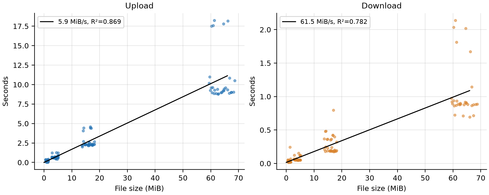
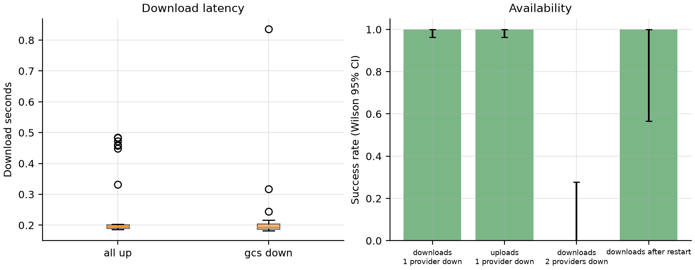
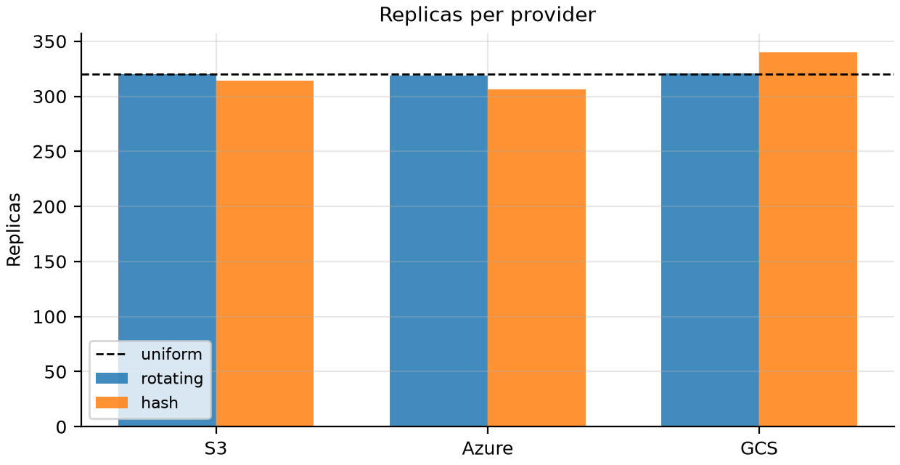
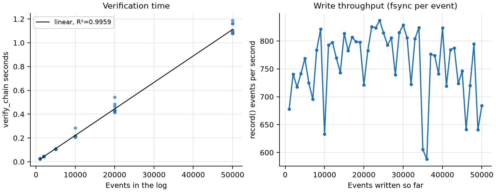
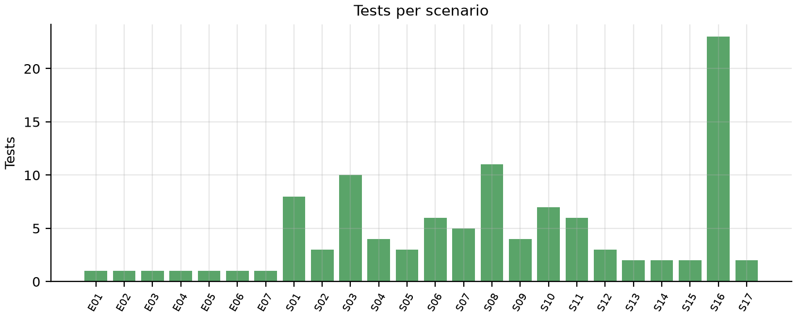
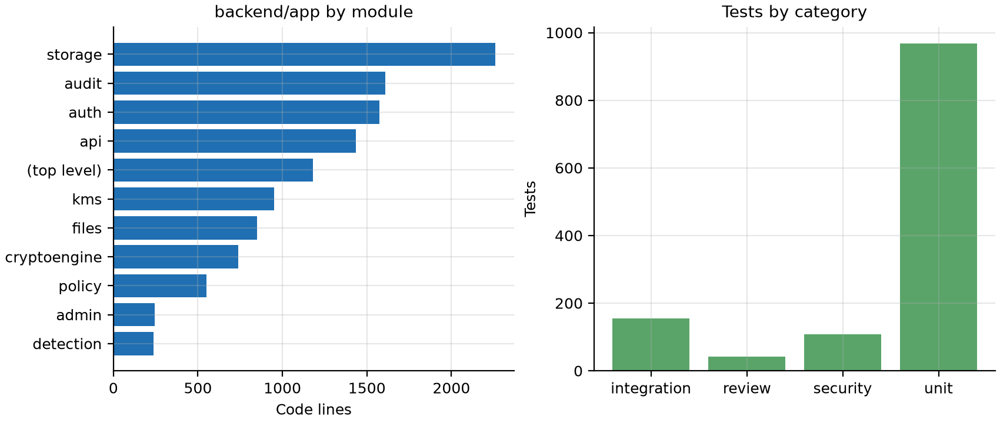

# Statistical analysis of the framework

## Key findings

* Time grows roughly linearly with size (R² 0.869 upload, 0.782 download; the rest is run-to-run scatter): the marginal rate is 5.9 MiB/s upload (95% CI 5.5 to 6.4) and 61.5 MiB/s download (95% CI 56.1 to 68.1).
* The whole security pipeline makes a 16 MiB upload 1.15 times slower than plain chunked storage of the same bytes (difference 0.502 s, 95% CI 0.035 to 0.969; Mann-Whitney U p 0.0080) and a download 3.40 times slower (difference 0.283 s, 95% CI 0.213 to 0.354); AES-256-GCM with SHA-256 alone explains about 3% of the upload overhead and 5% of the download overhead.
* Chunk size matters: throughput differs between 256 KiB, 1, 4 and 16 MiB chunks (Kruskal-Wallis upload p < 0.0001, download p < 0.0001; eta squared 0.94 and 0.84); the best median upload is at 16384 KiB (32.4 MiB/s) against 1.4 MiB/s at 256 KiB.
* With one of three providers killed, 100/100 downloads and 100/100 uploads still succeeded (Wilson 95% lower bound 96.3% and 96.3%), and steady-state download latency changed by -31.4 ms (95% CI -91.2 to 28.5; Mann-Whitney U p 0.2116); with two providers down 0/10 downloads succeeded, the documented limit of 2-way replication.
* Placement is balanced: replicas per provider rotating: {'aws-s3': 320, 'azure-blob': 319, 'gcs': 321} (chi2 0.01, p 0.9969); hash: {'aws-s3': 314, 'azure-blob': 306, 'gcs': 340} (chi2 1.98, p 0.3725) (no evidence against uniformity).
* Stored objects look random whatever the plaintext: mean ciphertext entropy random 7.9998, english_text 7.9998, zeros 7.9998 bits per byte against plaintext entropy of 8.00, 4.31, 0.00; the chi-square test rejected uniformity for 4 of 48 objects (about 5% would be expected by chance).
* Audit verification is linear: the log-log slope of time against events is 0.976 (95% CI 0.961 to 0.991; 1 means linear), R² 0.9959 for the linear fit (0.022 ms per 1000 events); `record()` sustains 758 events/s with an fsync per event.
* The security suite stopped or detected 108 of 108 designed attack and failure tests, none missed (Wilson 95% interval 96.6% to 100.0%; designed scenarios, not a random sample).
* The 1273-test suite covers 92.6% of the 8228 statements in backend/app (pytest-cov line coverage).

Everything in this report was measured by the scripts in `analysis/` on the machine described below, from the code at the commit shown. Raw data are in `analysis/data/*.csv`, figures in `analysis/figures/`, and `analysis/run_all.sh` reproduces all of it. No number was typed in by hand: they are computed from the CSV files by `analysis/analyze.py`.

## Environment and method

| Item | Value |
|---|---|
| Date | 2026-11-26T04:50:44+00:00 |
| Hardware | Intel(R) Core(TM) Ultra 9 185H, 22 logical CPUs, 15.3 GiB RAM |
| OS | Linux-6.18.33.2-microsoft-standard-WSL2-x86_64-with-glibc2.39 |
| Python / numpy / scipy / pandas / matplotlib | 3.12.3 / 2.5.5 / 1.18.1 / 3.1.1 / 3.11.2 |
| Git commit | 511eb14 (no uncommitted changes in backend/app; the later commits that add tests and documentation change no application code) |
| Random seed | 20261125 (order of conditions, bootstrap resampling) |
| Repetitions | n = 30 per condition after 3 discarded warm-up repetitions |
| Setting | three local emulators (moto S3, Azurite, gcp-storage-emulator) and the real boto3, azure-storage-blob and google-cloud-storage SDKs on one machine under WSL2; no network latency |

* **Statistics.** Per condition: n, mean, SD, median, 95% t-interval of the mean and 95% percentile-bootstrap interval of the median (5000 resamples). Two-group comparisons report both Welch's t-test and the Mann-Whitney U test; the primary test is Welch's when both samples pass a Shapiro-Wilk check at 0.05 and Mann-Whitney otherwise. Several groups: one-way ANOVA and Kruskal-Wallis (primary Kruskal-Wallis unless every group is normal), pairwise Mann-Whitney with Holm correction. Proportions: Wilson 95% intervals.
* **Design.** Conditions were interleaved in a random order within each repetition, so slow or fast periods of the machine affect them alike. Successive requests to one server are not fully independent (caches, background threads); the interleaving reduces but does not remove that.
* **Honest limits.** Local emulators on one machine, no network latency, and the attack outcomes are designed scenarios, not a random sample. Absolute times are specific to this machine; ratios and shapes are the transferable part.

## a. Upload and download against file size

One real API server (1 MiB chunks, the framework default), files of 1, 4, 16 and 64 MiB, each uploaded and downloaded n times through the full stack (authentication, policy, KMS, encryption, replication to 2 of 3 emulators with read-back verification, audit). 0 of 240 transfers failed or did not verify; the rest are analysed.

**Time per transfer**

| Op | Size | n | Mean s | SD s | Median s | 95% CI of mean (s) | Mean MiB/s | Shapiro p |
|---|---|---|---|---|---|---|---|---|
| upload | 1 MiB | 30 | 0.181 | 0.112 | 0.205 | [0.139, 0.223] | 9.8 | 0.005 |
| upload | 4 MiB | 30 | 0.698 | 0.206 | 0.631 | [0.621, 0.775] | 6.1 | 0.000 |
| upload | 16 MiB | 30 | 2.669 | 0.796 | 2.296 | [2.372, 2.966] | 6.4 | 0.000 |
| upload | 64 MiB | 30 | 10.803 | 3.268 | 9.319 | [9.582, 12.023] | 6.3 | 0.000 |
| download | 1 MiB | 30 | 0.035 | 0.042 | 0.021 | [0.019, 0.050] | 40.9 | 0.000 |
| download | 4 MiB | 30 | 0.067 | 0.029 | 0.054 | [0.056, 0.077] | 66.9 | 0.000 |
| download | 16 MiB | 30 | 0.289 | 0.140 | 0.220 | [0.237, 0.342] | 65.1 | 0.000 |
| download | 64 MiB | 30 | 1.054 | 0.416 | 0.889 | [0.898, 1.209] | 67.0 | 0.000 |

**Linear model: seconds = intercept + slope x size (ordinary least squares on all individual transfers)**

| Op | Slope s/MiB | 95% CI | Throughput MiB/s | 95% CI | Intercept s | 95% CI | R² |
|---|---|---|---|---|---|---|---|
| upload | 0.1686 | [0.1567, 0.1805] | 5.9 | [5.5, 6.4] | 0.005 | [-0.390, 0.400] | 0.8689 |
| download | 0.0163 | [0.0147, 0.0178] | 61.5 | [56.1, 68.1] | 0.016 | [-0.036, 0.067] | 0.7816 |

*Time against file size with the fitted line (n = 30 per point, 1 MiB chunks).* ([PDF](../analysis/figures/a_scaling.pdf))

**What this shows.** Transfer time grows roughly linearly with file size (R² 0.87 upload, 0.78 download), so throughput is mostly a property of the pipeline rather than of the file size. The intercepts' confidence intervals include zero, so no fixed per-request cost is resolved at these sizes (the 1 MiB transfers are dominated by run-to-run scatter). Upload is much slower than download because every chunk is written to two providers and read back for verification. **Limitations.** Variance rises with size, so the least-squares standard errors are approximate and the linear fit leaves a good deal unexplained; emulators have no network latency; one machine.

## b. Cost of security

The same bytes stored three ways, against the same emulators and through the same provider adapters: **app** = the full framework; **plain chunked** = a harness outside the application that splits the file into 1 MiB chunks and writes each plain chunk to 2 of the 3 providers in parallel (rotating placement), with no encryption, manifest, database, policy, audit or read-back verification; **plain single** = one object to one provider. The plain arms are the cheapest possible storage of these bytes; the difference to the app is the price of the whole security pipeline, not of encryption alone.

**Time per transfer by arm**

| Op | Size | Arm | n | Mean s | SD s | Median s | 95% CI of mean (s) |
|---|---|---|---|---|---|---|---|
| upload | 4 MiB | app | 30 | 1.060 | 0.300 | 0.995 | [0.948, 1.171] |
| upload | 4 MiB | plain_chunked | 30 | 0.885 | 0.263 | 0.825 | [0.787, 0.983] |
| upload | 4 MiB | plain_single | 30 | 0.027 | 0.010 | 0.028 | [0.024, 0.031] |
| upload | 16 MiB | app | 30 | 3.847 | 0.981 | 4.034 | [3.481, 4.214] |
| upload | 16 MiB | plain_chunked | 30 | 3.345 | 0.817 | 3.580 | [3.040, 3.650] |
| upload | 16 MiB | plain_single | 30 | 0.091 | 0.028 | 0.097 | [0.080, 0.102] |
| upload | 64 MiB | app | 30 | 15.688 | 3.823 | 18.270 | [14.261, 17.116] |
| upload | 64 MiB | plain_chunked | 30 | 13.830 | 3.288 | 16.068 | [12.602, 15.058] |
| upload | 64 MiB | plain_single | 30 | 0.471 | 0.142 | 0.523 | [0.418, 0.524] |
| download | 4 MiB | app | 30 | 0.117 | 0.079 | 0.117 | [0.087, 0.146] |
| download | 4 MiB | plain_chunked | 30 | 0.027 | 0.010 | 0.029 | [0.024, 0.031] |
| download | 4 MiB | plain_single | 30 | 0.012 | 0.004 | 0.011 | [0.010, 0.013] |
| download | 16 MiB | app | 30 | 0.401 | 0.182 | 0.417 | [0.333, 0.469] |
| download | 16 MiB | plain_chunked | 30 | 0.118 | 0.050 | 0.137 | [0.099, 0.137] |
| download | 16 MiB | plain_single | 30 | 0.034 | 0.013 | 0.029 | [0.030, 0.039] |
| download | 64 MiB | app | 30 | 1.531 | 0.523 | 1.614 | [1.336, 1.726] |
| download | 64 MiB | plain_chunked | 30 | 0.476 | 0.170 | 0.575 | [0.413, 0.540] |
| download | 64 MiB | plain_single | 30 | 0.202 | 0.052 | 0.209 | [0.183, 0.222] |

**Overhead of the full pipeline over plain chunked storage (six comparisons, Holm-adjusted)**

| Op | Size | App minus plain chunked (s) | 95% CI (Welch) | Ratio app/plain | Primary test | p | p (Holm) | Cohen d | Cliff delta |
|---|---|---|---|---|---|---|---|---|---|
| upload | 4 MiB | 0.175 | [0.029, 0.321] | 1.20 | Mann-Whitney U | 0.0122 | 0.0159 | 0.6 | 0.38 |
| upload | 16 MiB | 0.502 | [0.035, 0.969] | 1.15 | Mann-Whitney U | 0.0080 | 0.0159 | 0.6 | 0.40 |
| upload | 64 MiB | 1.858 | [0.014, 3.702] | 1.13 | Mann-Whitney U | 0.0014 | 0.0041 | 0.5 | 0.48 |
| download | 4 MiB | 0.089 | [0.060, 0.119] | 4.27 | Mann-Whitney U | < 0.0001 | < 0.0001 | 1.6 | 1.00 |
| download | 16 MiB | 0.283 | [0.213, 0.354] | 3.40 | Mann-Whitney U | < 0.0001 | < 0.0001 | 2.1 | 0.98 |
| download | 64 MiB | 1.055 | [0.851, 1.258] | 3.21 | Mann-Whitney U | < 0.0001 | < 0.0001 | 2.7 | 1.00 |

**CPU cost of the cipher itself (the same calls the application makes, 16 MiB per repetition)**

| Cipher alone, no I/O | n | Mean ms per MiB | SD | 95% CI | MiB/s |
|---|---|---|---|---|---|
| encrypt (AES-256-GCM + SHA-256) | 30 | 0.844 | 0.055 | [0.823, 0.864] | 1185 |
| decrypt (SHA-256 check + AES-256-GCM) | 30 | 0.808 | 0.096 | [0.773, 0.844] | 1237 |

*Mean time with 95% confidence intervals: the framework against plain chunked and plain single-object storage.* ([PDF](../analysis/figures/b_overhead.pdf))

**What this shows.** The pipeline is slower than plain chunked storage at every size and operation (largest Holm-adjusted p 0.0159): uploads take 1.13 to 1.20 times as long and downloads 3.21 to 4.27 times. The cipher itself is a small part of the difference (about 3% of the upload and 5% of the download overhead at 16 MiB); the remainder is everything else the pipeline does and plain storage does not (HTTP request handling, metadata commits, audit events, policy checks, read-back verification and spooling), which this experiment did not separate. **Limitations.** The plain arms are a lower bound (they do not authenticate, authorise, log or verify), so the overhead is the price of the whole pipeline, not a like-for-like comparison with an encryption-only design; emulators only.

## c. Effect of chunk size

A 32 MiB file through four servers that differ only in chunk size (256 KiB, 1 MiB, 4 MiB, 16 MiB), interleaved in random order.

**Throughput by chunk size**

| Op | Chunk | n | Mean MiB/s | SD | Median | 95% CI of mean | Shapiro p |
|---|---|---|---|---|---|---|---|
| upload | 256 KiB | 30 | 1.4 | 0.1 | 1.4 | [1.3, 1.4] | 0.231 |
| upload | 1024 KiB | 30 | 5.0 | 0.4 | 5.0 | [4.9, 5.2] | 0.752 |
| upload | 4096 KiB | 30 | 14.6 | 1.7 | 14.6 | [14.0, 15.2] | 0.228 |
| upload | 16384 KiB | 30 | 32.5 | 5.7 | 32.4 | [30.4, 34.6] | 0.021 |
| download | 256 KiB | 30 | 25.9 | 2.4 | 25.8 | [25.0, 26.8] | 0.229 |
| download | 1024 KiB | 30 | 69.4 | 16.1 | 75.8 | [63.4, 75.4] | 0.002 |
| download | 4096 KiB | 30 | 114.3 | 17.3 | 119.5 | [107.9, 120.8] | 0.000 |
| download | 16384 KiB | 30 | 118.3 | 23.1 | 123.4 | [109.7, 126.9] | 0.001 |

**Does throughput depend on chunk size? (3 degrees of freedom)**

| Op | ANOVA F | ANOVA p | Kruskal-Wallis H | KW p | Primary | Eta squared |
|---|---|---|---|---|---|---|
| upload | 651.5 | < 0.0001 | 111.6 | < 0.0001 | Kruskal-Wallis | 0.944 |
| download | 206.5 | < 0.0001 | 93.6 | < 0.0001 | Kruskal-Wallis | 0.842 |

**Pairwise Mann-Whitney U tests**

| Op | Pair | Median ratio (second/first) | p | p (Holm) |
|---|---|---|---|---|
| upload | 256 vs 1024 KiB | 3.69 | < 0.0001 | < 0.0001 |
| upload | 256 vs 4096 KiB | 10.67 | < 0.0001 | < 0.0001 |
| upload | 256 vs 16384 KiB | 23.77 | < 0.0001 | < 0.0001 |
| upload | 1024 vs 4096 KiB | 2.89 | < 0.0001 | < 0.0001 |
| upload | 1024 vs 16384 KiB | 6.44 | < 0.0001 | < 0.0001 |
| upload | 4096 vs 16384 KiB | 2.23 | < 0.0001 | < 0.0001 |
| download | 256 vs 1024 KiB | 2.94 | < 0.0001 | < 0.0001 |
| download | 256 vs 4096 KiB | 4.63 | < 0.0001 | < 0.0001 |
| download | 256 vs 16384 KiB | 4.78 | < 0.0001 | < 0.0001 |
| download | 1024 vs 4096 KiB | 1.58 | < 0.0001 | < 0.0001 |
| download | 1024 vs 16384 KiB | 1.63 | < 0.0001 | < 0.0001 |
| download | 4096 vs 16384 KiB | 1.03 | 0.0905 | 0.0905 |

*Throughput by chunk size for a 32 MiB file (n = 30 per box).* ([PDF](../analysis/figures/c_chunk.pdf))

**What this shows.** Larger chunks raise throughput: the median goes up with every step for uploads (the last step, 4096 to 16384 KiB, is still a factor 2.23), while downloads flatten out between 4096 and 16384 KiB (factor 1.03). Fewer chunks mean fewer provider requests and database rows for the same bytes. **Limitations.** One file size; emulators have no per-request network latency, which on real providers would favour larger chunks even more; a chunk is also the unit of retry and repair, which this experiment does not measure.

## d. Fault tolerance: a real emulator outage

The gcs-storage emulator process was killed with `scripts/emulators.sh stop-one gcs` while a file uploaded before the outage was downloaded repeatedly and new files were uploaded. Then a second emulator (Azurite) was stopped to show the limit of 2-way replication, and both were restarted.

**Download latency (16 MiB file, 1 MiB chunks)**

| Condition | n | Mean s | SD s | Median s | Note |
|---|---|---|---|---|---|
| download, all providers up | 30 | 0.253 | 0.113 | 0.196 | - |
| download, gcs down (trials 4 to 33) | 30 | 0.221 | 0.119 | 0.194 | - |
| download, gcs down, first 3 trials after the outage | 3 | 0.367 | - | 0.190 | failover and breaker adapting |

**Does one provider down change steady-state download latency?**

| Comparison | Mean difference (s) | 95% CI (Welch) | Ratio | Primary test | p | Cohen d | Cliff delta |
|---|---|---|---|---|---|---|---|
| gcs down minus all up | -0.0314 | [-0.0912, 0.0285] | 0.876 | Mann-Whitney U | 0.2116 | -0.27 | -0.19 |

**Success rates**

| Scenario | Trials | Successes | Success rate | Wilson 95% CI |
|---|---|---|---|---|
| downloads, 1 provider down | 100 | 100 | 100.0% | [96.3%, 100.0%] |
| uploads, 1 provider down | 100 | 100 | 100.0% | [96.3%, 100.0%] |
| downloads, 2 providers down | 10 | 0 | 0.0% | [0.0%, 27.8%] |
| downloads after restart | 5 | 5 | 100.0% | [56.6%, 100.0%] |

Placement during the outage: replicas of the files uploaded while gcs was down: `{"aws-s3": 400, "azure-blob": 400}` (0 on gcs). After the emulators were restarted the first good download came 2.2 s later.

*Download latency with and without one provider, and success rates with Wilson intervals.* ([PDF](../analysis/figures/d_fault.pdf))

**What this shows.** A real outage of one provider does not stop reads or writes (reads fail over to the surviving replica, writes are placed on the other providers) and shows no detectable change in steady-state latency (the confidence interval of the difference includes zero), while two providers down breaks reads of chunks whose two replicas were both on them, as designed. **Limitations.** The emulator refuses connections immediately; a provider that hangs would be detected only after the 30 s deadline in the container deployment; one outage pattern.

## e. Placement balance

60 uploads of an 8 MiB file (480 chunks, 960 replicas) per placement strategy; replicas counted from the metadata database. Null hypothesis: replicas are spread uniformly over the three providers. Chunks of one file are not independent draws, so the p-values are approximate.

**Replicas per provider and chi-square goodness of fit against uniform**

| Strategy | S3 | Azure | GCS | Expected each | chi2 (2 df) | p | Chunks per provider pair | chi2 pairs | p pairs |
|---|---|---|---|---|---|---|---|---|---|
| rotating | 320 | 319 | 321 | 320.0 | 0.01 | 0.9969 | 159/161/160 | 0.01 | 0.9938 |
| hash | 314 | 306 | 340 | 320.0 | 1.98 | 0.3725 | 140/174/166 | 3.95 | 0.1388 |

*Replicas per provider for the two placement strategies against a uniform expectation.* ([PDF](../analysis/figures/e_placement.pdf))

**What this shows.** Neither strategy concentrates chunks on one provider, so a single provider holds about two thirds of the chunks and none holds all. **Limitations.** A non-rejected chi-square test is absence of evidence of imbalance, not proof of uniformity; chunks within a file are dependent; the rotating strategy is balanced by construction.

## f. Ciphertext randomness at the providers

Objects were read raw from the emulators through each provider's own SDK, exactly as a holder of a provider credential would see them, for 16 MiB files of random bytes, English text and zeros. For each stored object: Shannon entropy in bits per byte and a chi-square test of the byte frequencies against uniform (255 degrees of freedom). Replicas of one chunk are the same bytes and are counted once.

**Entropy and byte-frequency tests of the stored objects**

| Plaintext | Objects | Plaintext entropy (bits/byte) | Ciphertext entropy mean | SD | Chi-square rejections at 0.05 | Wilson 95% of rate | KS p of p-values vs uniform |
|---|---|---|---|---|---|---|---|
| random | 16 | 7.9998 | 7.99982 | 0.00002 | 1/16 | [1.1%, 28.3%] | 0.7106 |
| english_text | 16 | 4.3141 | 7.99982 | 0.00001 | 1/16 | [1.1%, 28.3%] | 0.7364 |
| zeros | 16 | 0.0000 | 7.99983 | 0.00002 | 2/16 | [3.5%, 36.0%] | 0.6109 |

*Entropy of stored ciphertext against plaintext, and the distribution of chi-square p-values.* ([PDF](../analysis/figures/f_entropy.pdf))

**What this shows.** A provider that reads its own objects sees data statistically indistinguishable from random bytes, even when the plaintext is all zeros. **Limitations.** Passing these tests is necessary, not sufficient, for security (the guarantee comes from AES-256-GCM, not from the tests); object sizes, counts and timing remain visible to a provider.

## g. Audit log: verification scaling and write throughput

Events were written to a fresh hash-chained audit log (each one fsynced), and `verify_chain` (hash chain, signed checkpoints and anchors) was timed at each size.

**verify_chain time**

| Events | n | Mean s | SD s | Median s | 95% CI of mean | Chain valid |
|---|---|---|---|---|---|---|
| 1003 | 10 | 0.0255 | 0.0013 | 0.0257 | [0.0245, 0.0264] | 10/10 |
| 2003 | 10 | 0.0449 | 0.0017 | 0.0449 | [0.0437, 0.0461] | 10/10 |
| 5003 | 10 | 0.1061 | 0.0015 | 0.1061 | [0.1051, 0.1072] | 10/10 |
| 10003 | 10 | 0.2188 | 0.0234 | 0.2113 | [0.2021, 0.2355] | 10/10 |
| 20003 | 10 | 0.4472 | 0.0396 | 0.4315 | [0.4189, 0.4756] | 10/10 |
| 50003 | 10 | 1.1117 | 0.0418 | 1.0921 | [1.0818, 1.1417] | 10/10 |

**Is verification linear in the number of events? (a log-log slope of 1 means linear)**

| Model | Slope | 95% CI | Intercept | R² |
|---|---|---|---|---|
| seconds = a + b x events | 0.0223 ms/1000 events | [0.0219, 0.0226] | -0.0007 s | 0.9959 |
| log10 seconds = a + b log10 events | 0.976 | [0.961, 0.991] | -4.556 | 0.9968 |

`record()` throughput over 50000 events: mean 758 events/s (SD 62, 95% CI of the mean 740 to 775); trend against log size -0.544 events/s per 1000 events (95% CI -1.761 to +0.672, p 0.3727).

*verify_chain time against log size with a linear fit, and record() throughput as the log grows.* ([PDF](../analysis/figures/g_audit.pdf))

**What this shows.** Verifying the whole log costs time proportional to its length, and no trend in the write rate is detectable as the log grows (the confidence interval of the trend includes zero), so the audit log can be checked routinely. **Limitations.** Memory-backed providers hold the anchors here, SQLite on one disk; a PostgreSQL deployment was not measured; the per-event fsync cost depends on the disk.

## h. Detection of attacks and tampering

Outcomes of the security suite (`scripts/attacks/run_all.sh`): each row is one designed attack or failure scenario with its observed result and audit record. **This is a table of designed scenarios, not a random sample of attacks**, so the intervals below say how well the suite supports the claim, not what an unknown attacker would achieve.

**Scenarios (S = attack, E = provider failure)**

| Scenario | Attack or failure (first test) | Tests passed |
|---|---|---|
| E01 | Kill the gcp-storage-emulator process (real outage) | 1/1 |
| E02 | Delete every Azure copy of a file's chunks via the Azure SDK | 1/1 |
| E03 | Overwrite every S3 copy of a file's chunks via boto3 with sa | 1/1 |
| E04 | Every call to Azure times out (fault mode 'timeout' over the | 1/1 |
| E05 | GCS fails the next 2 calls (fault mode fail-n) during upload | 1/1 |
| E06 | Delete one chunk at EVERY provider holding it (via each SDK) | 1/1 |
| E07 | GCS down AND the other replica of some chunks lost; GCS come | 1/1 |
| S01 | Forge a token with alg=none (algorithm confusion) | 8/8 |
| S02 | Use a still-valid token whose session has been idle > 30 min | 3/3 |
| S03 | bob keeps using alice's file after alice revokes the share | 10/10 |
| S04 | Admin (fresh MFA) downloads / deletes / shares a user's file | 4/4 |
| S05 | Flip one bit in BOTH replicas of one chunk | 3/3 |
| S06 | Set files.owner_id to the attacker's user id in the metadata | 6/6 |
| S07 | Swap chunks 0/1 AND re-seal a consistent manifest (simulated | 5/5 |
| S08 | Two deployments (different keystores) write checkpoints at t | 11/11 |
| S09 | With provider A's credential: delete-everything (chunks AND  | 4/4 |
| S10 | Try one leaked password against 6 different usernames from o | 7/7 |
| S11 | Stolen password (account inside the TOFU window): enrol + ac | 6/6 |
| S12 | Token of a session opened inside the allow list used from ou | 3/3 |
| S13 | Valid session downloads every file in a loop (bulk export) | 2/2 |
| S14 | Thief replays a refresh token the legitimate client already  | 2/2 |
| S15 | Admin disables alice / demotes an auditor while their tokens | 2/2 |
| S16 | Filename with quotes/CRLF/;/<script> to break Content-Dispos | 23/23 |
| S17 | Check every stored event: actor format, no _dropped detail k | 2/2 |

**Confusion-style summary**

| Attempts (tests) | Stopped or detected | Missed | Rate | Wilson 95% CI |
|---|---|---|---|---|
| 108 | 108 | 0 | 100.0% | [96.6%, 100.0%] |

*Number of tests per attack or failure scenario (108 of 108 passed).* ([PDF](../analysis/figures/h_attacks.pdf))

**What this shows.** Every designed scenario ended in a block, a detection or a documented limit, with an audit record. **Limitations.** A passing suite shows the checks work for the scenarios someone thought of; it says nothing about unknown ones, and no external penetration test was done.

## i. Engineering metrics

**Lines of Python per module (code = not blank, not comment-only)**

| Module (backend/app) | Lines | Code lines |
|---|---|---|
| storage | 2680 | 2258 |
| audit | 1956 | 1609 |
| auth | 1875 | 1574 |
| api | 1830 | 1436 |
| (top level) | 1523 | 1182 |
| kms | 1160 | 951 |
| files | 962 | 851 |
| cryptoengine | 911 | 738 |
| policy | 671 | 549 |
| admin | 287 | 243 |
| detection | 279 | 238 |
| TOTAL | 14134 | 11629 |

**Lines by area**

| Area | Lines | Code lines |
|---|---|---|
| analysis | 1644 | 1389 |
| backend/app | 14134 | 11629 |
| backend/tests | 11850 | 9456 |
| frontend/src | 4698 | 4368 |
| scripts | 3595 | 2991 |

**Tests by category (pytest --collect-only)**

| Test category | Tests |
|---|---|
| integration | 155 |
| review | 42 |
| security | 108 |
| unit | 968 |
| TOTAL | 1273 |

**Tests by module**

| Category | Module | Tests |
|---|---|---|
| integration | app | 77 |
| integration | storage | 78 |
| review | test_review_audit | 7 |
| review | test_review_auth | 28 |
| review | test_review_input_config | 7 |
| security | test_e01_provider_failures | 7 |
| security | test_s01_s02_authentication | 11 |
| security | test_s03_s04_authorization | 14 |
| security | test_s05_s07_data_integrity | 14 |
| security | test_s08_audit_tampering | 11 |
| security | test_s09_provider_compromise | 4 |
| security | test_s10_brute_force | 7 |
| security | test_s11_s15_unc5537 | 15 |
| security | test_s16_input_handling | 23 |
| security | test_s17_audit_privacy | 2 |
| unit | audit | 187 |
| unit | auth | 79 |
| unit | bench | 25 |
| unit | cryptoengine | 103 |
| unit | deploy | 8 |
| unit | kms | 73 |
| unit | policy | 339 |
| unit | storage | 145 |
| unit | test_ratelimit | 6 |
| unit | test_ratelimit_audit | 3 |

**Line coverage of backend/app by the whole suite (pytest-cov)**

| Module | Statements | Covered | Line coverage % |
|---|---|---|---|
| files | 632 | 558 | 88.3 |
| detection | 163 | 147 | 90.2 |
| storage | 1585 | 1440 | 90.9 |
| kms | 738 | 673 | 91.2 |
| admin | 160 | 146 | 91.2 |
| auth | 1048 | 962 | 91.8 |
| audit | 1051 | 985 | 93.7 |
| cryptoengine | 515 | 485 | 94.2 |
| api | 1115 | 1054 | 94.5 |
| policy | 325 | 311 | 95.7 |
| (top level) | 896 | 858 | 95.8 |
| TOTAL | 8228 | 7619 | 92.6 |

**Security findings history (all fixed)**

| Severity | independent review | own testing (Phase 8) | Total |
|---|---|---|---|
| high | 2 | 1 | 3 |
| medium-high | 0 | 1 | 1 |
| medium | 5 | 1 | 6 |
| low-medium | 0 | 1 | 1 |
| low | 8 | 2 | 10 |
| info | 2 | 0 | 2 |
| TOTAL | 17 | 6 | 23 |

*Code size per module and number of tests per category.* ([PDF](../analysis/figures/i_engineering.pdf))

**What this shows.** The size of the code, how the tests are spread over categories and modules, and that all 23 recorded weaknesses (6 found by our own testing, 17 by the independent review) are fixed. **Limitations.** Lines of code and test counts are size measures, not quality measures; coverage is line coverage, which does not show whether the assertions are strong; severities are the team's assessments.
